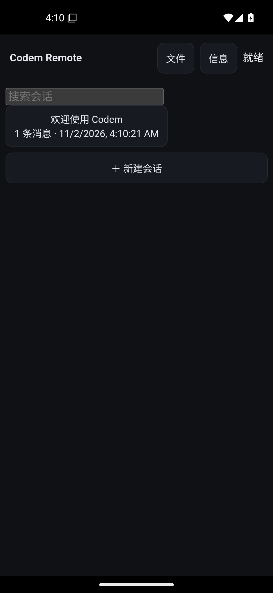
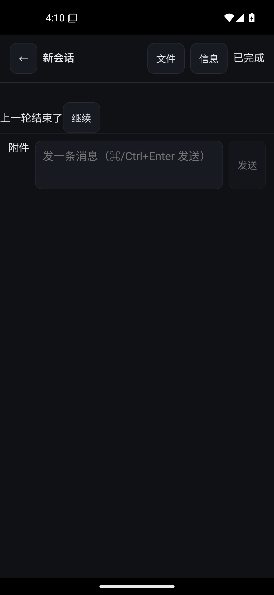
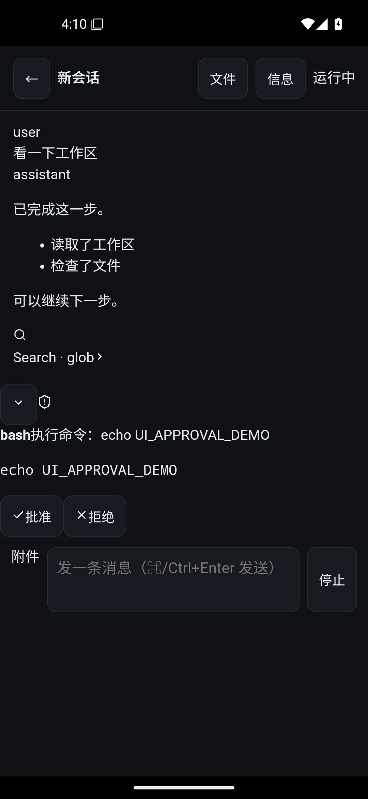
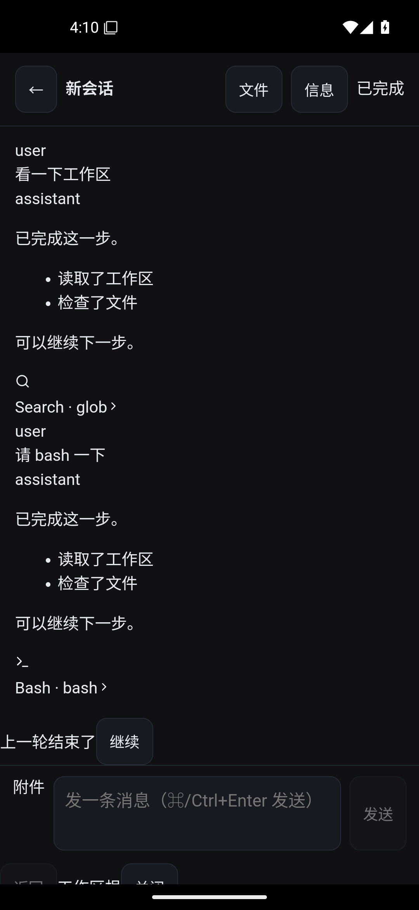
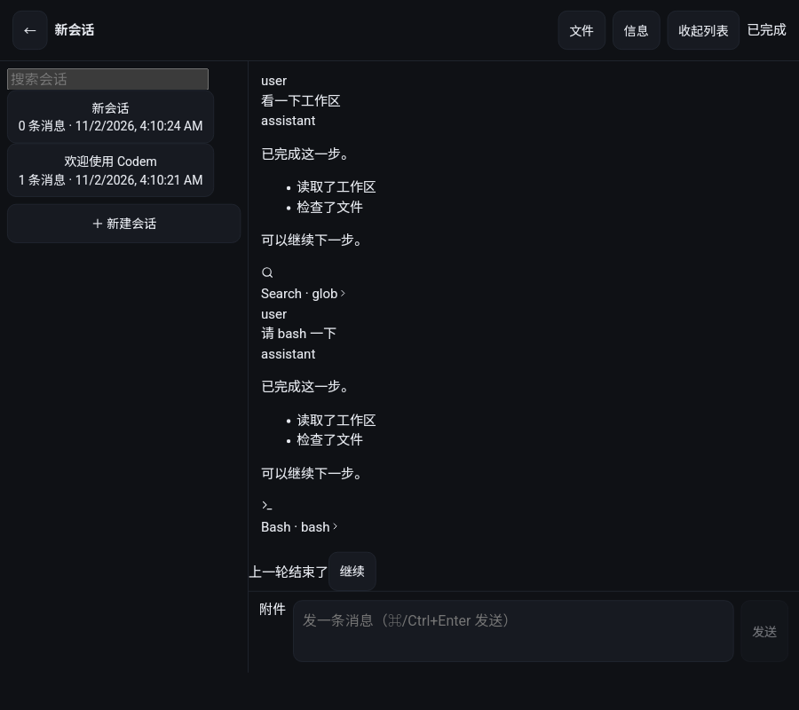
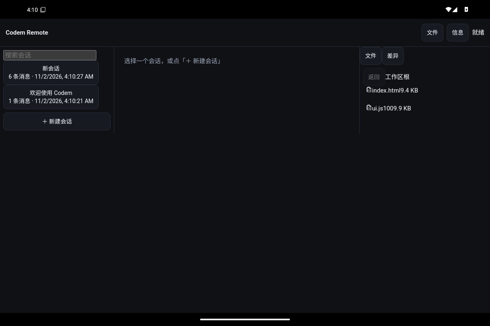

# Android 端 UI 对标评审（真机截图 + 分析）

> 目的：回答一个问题——**安卓端界面是否达到了“沿用 Codem UI”的设计预期？**
> 方法：真机（Android 15 x86_64）跑 UI 取证脚本，截取列表/对话/审批/文件/宽屏三列；
> 同时用 DOM 计数排除截图假象。截图见 `docs/architecture/evidence/ui-*.png`。

## 1. 截图

| 状态 | 截图 |
|---|---|
| 会话列表（窄屏） |  |
| 对话：流式正文 + 工具卡 + 继续 |  |
| 审批卡（命令 + 允许/拒绝） |  |
| 文件浏览（弹层） |  |
| 宽屏双列（900px） |  |
| 宽屏三列（物理 1200×800） |  |

## 2. 结论（先说答案）

**功能矩阵达到了；但“沿用 Codem UI / 桌面与手机同一套组件”没有达到。**
现在跑在 Android 上的是 `packages/ui` —— 一套**为远程共享而写的极简移动 UI**，
不是桌面 Codem 的界面；桌面仍然用自己的 `src/components`。这违反 ADR-0003 的
“桌面继续用同一套组件（不允许 fork）”，属于**负向架构偏差**，不是单纯视觉差异。

## 3. 逐项对照

### 3.1 已达到（有真机取证）

- 会话列表 + 搜索 + 新建；窄屏单列（列表 ⇄ 对话，有返回）；
- 流式正文；工具卡（名称/状态/输出，长结果可展开）；审批卡（命令可见、允许/拒绝）；
- 运行中引导（「引导」按钮）、结束后「继续」（不自动续跑）；
- 文件树/只读预览、git diff；宽屏双列 280+对话、三列 +320 文件常驻（DC-12/13）；
- 断线/状态、租约、审批、错误横幅都走同一套 Transport。

### 3.2 没达到（设计预期 vs 实际）

| 设计预期 | 实际 | 性质 |
|---|---|---|
| 桌面与手机**同一套 UI 组件** | `packages/ui` 与 `src/components` 两套；桌面未接共享 UI | **负向架构偏差** |
| Markdown/代码块渲染（桌面能力） | 纯文本 + `<pre>`；截图里 `- 读取了工作区` 原样显示 | 负向（能力缺失） |
| 富工具卡（参数、diff、文件变更、折叠详情） | 简化卡：名称 + 输出文本 | 负向（简化） |
| 模型/安全/插件等设置入口 | 无（仅 Host 连接与文件） | 负向（矩阵未做） |
| 附件、多模态 | 无 | 负向（矩阵未做） |
| 视觉语言（桌面主题/密度/组件） | 深色极简壳，字体/间距/卡片与桌面不同 | 负向（视觉不统一） |
| 移动端信息密度（底部安全区、键盘） | 基本可用；输入区在真机键盘弹出时未专门适配 | 待验 |

### 3.3 评审中修掉的问题

1. **工具名丢失**：bash 卡显示 `tool ✓`（应为 `bash ✓`）。根因是 `session.get` 没带
   `tool_call_id`，UI 只靠事件顺序回填，刷新/重进会话就丢名字。已修：Host 返回
   `toolCallId`，UI 从持久化的 `assistant.toolCalls` 恢复名字（判据：`ui-session-chat` 新用例）。
2. 输入区同时显示「发送/停止」；已改为空闲只显示发送、运行中显示停止（有内容时加「引导」）。
3. 搜索框只占一半宽度；已改为 100%。
4. 宽屏 1200 用 CDP 改视口截图会出现**旧帧残留**（同一 DOM 只有 1 个 sidebar，DOM 计数为证）。
   已改用物理分辨率 1200×800 截图，得到干净三列图；这不是应用 bug，但取证方式要固定下来。

## 4. 为什么说“不是沿用 Codem UI”

- 桌面 `src/components` 的聊天/工具/设置组件没有被 Android 复用；
- `packages/ui` 是 Spike C 为了验证“同一 Transport + 远程渲染”写的最小壳，
  文件头也写着“最小替身”。它证明了协议与链路，但**不等于产品 UI**；
- 结果：同一句话在桌面和手机上的呈现（Markdown、代码高亮、工具详情、主题）不一致。

## 5. 决策与进展（2026-11）

已选 **A（统一组件）**，计划见 `UI-UNIFY-PLAN.md`。本轮完成 Phase 1：

- 共享 Markdown（GFM + PrismLight）已接入并真机截图验证（`ui-chat.png`）；
- 断点改为手机 <600 / 平板 600–999 / 宽屏 ≥1000；触控 44px、安全区、16px 输入；
- 工具名恢复判据、发送/停止互斥、搜索框宽度已修；
- Phase 2 已开始：共享 `ToolCardView`（参数/状态/耗时/折叠/diff 着色）接入移动端；
- Phase 3 已加只读「信息」面板（hostId/能力/事件水位/运行数/工作区）。

## 6. 建议（按优先级）

1. **P0（架构）**：二选一，不能继续两套：
   - A. 把桌面聊天/工具/审批/设置面板抽成 `packages/ui` 的组件，桌面改为消费共享包；
   - B. 明确接受“移动端是精简 UI”的产品决策，写进 ADR 并删除“同一套组件”的承诺。
2. **P1（体验）**：Markdown + 代码块、富工具卡（参数/结果折叠/diff）、移动键盘与安全区适配。
3. **P2（矩阵）**：附件、设置只读、插件列表只读。
4. **P3**：一次性配对码/设备身份；arm64 真机。

## 6. 复跑

```powershell
$env:ANDROID_SDK_ROOT="...\Android\Sdk"
node android-shell\spike-ui-shots.mjs   # 产出 evidence/ui-*.png + ui-shots.json
```

脚本会 `pm clear`，不留测试数据。
