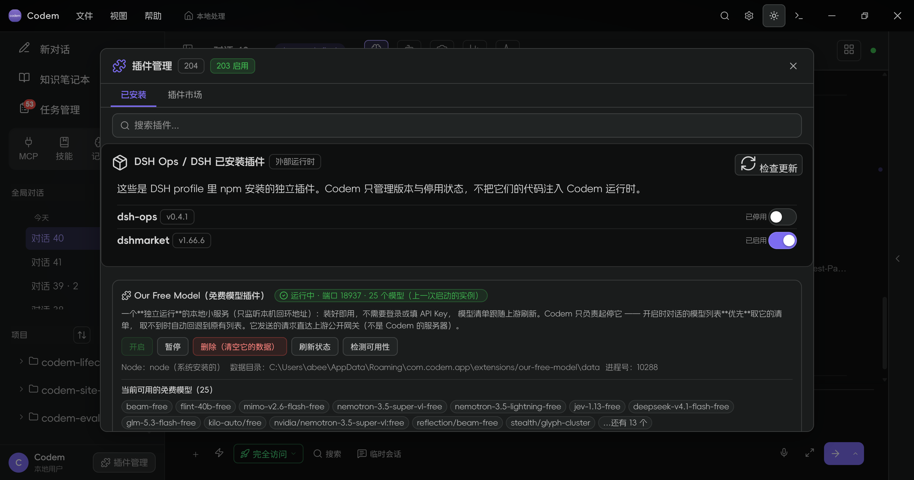
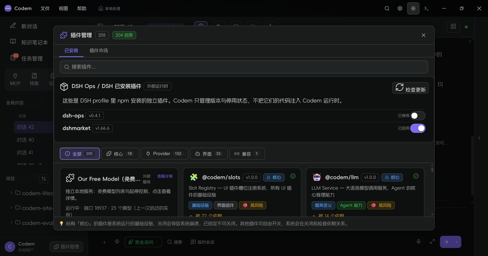
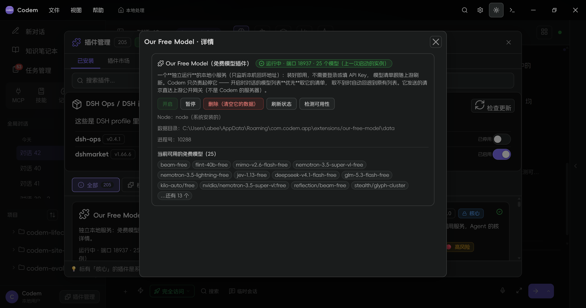

# 插件更新（外部 DSH 插件）

Codem 的「插件管理 → 已安装」里新增了一张 **DSH Ops / DSH 已安装插件** 卡片，用于管理 DSH profile 里通过 npm 安装的外部插件（当前真实用例：`dsh-ops`）。

## 它管理什么

- 安装位置：`<home>/.dsh/profiles/desktop`
- 读取：profile `package.json` 的 `dependencies` + `node_modules/<name>/package.json`
- 检查：`npm view <name> version`
- 升级：`npm install <name>@<latest> --no-audit --no-fund`，成功后**回读** `package.json` 确认
- 停用：只写 Codem 的 `codem-external-dsh-disabled` 设置，不把插件代码注入 Codem 运行时

## 使用

1. 打开「插件管理」→「已安装」；
2. 点 **检查更新**；
3. 有更新时显示 `v0.4.0 → v0.4.1` 与 **升级并安装**；
4. 点升级，卡片回读并显示新版本；
5. 右侧开关可停用/启用，刷新或重启后保持。



## 可靠性

- `npm view` 失败：卡片保留已安装版本并显示 error，不显示“已是最新”；
- `npm install` 非 0：返回 `ok=false`，版本不变，界面提示失败；
- 升级成功必须回读版本，版本没变不算成功；
- 判据：`src/test/external-dsh-plugins.test.ts` EXT-1..6。

## dsh-ops 真机验证

```text
安装版本 0.4.0
检查更新 → 0.4.1
升级并安装 → 回读 0.4.1
停用 → 刷新后仍为已停用
停用状态下 Codem 新会话/工具执行正常
```

停用只影响 Codem 的外部插件管理状态；dsh-ops 的代码从未被注入 Codem 运行时，所以不会影响 Codem 其他功能。


## 插件详情页

所有插件卡点击后都会弹出统一详情页：名称、版本、服务标签、依赖、被依赖、提供的服务、风险、启停按钮。免费模型插件的完整控制面板只放在它自己的详情页里；列表里只保留一张和其他插件同级的紧凑卡片。




