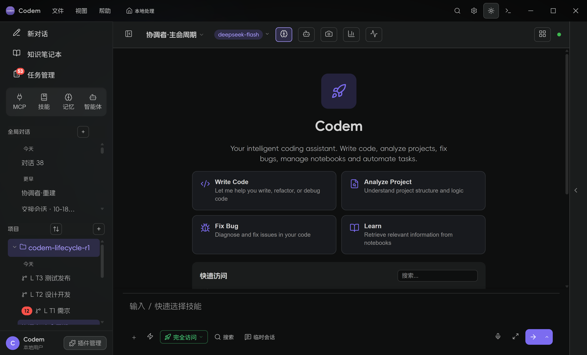
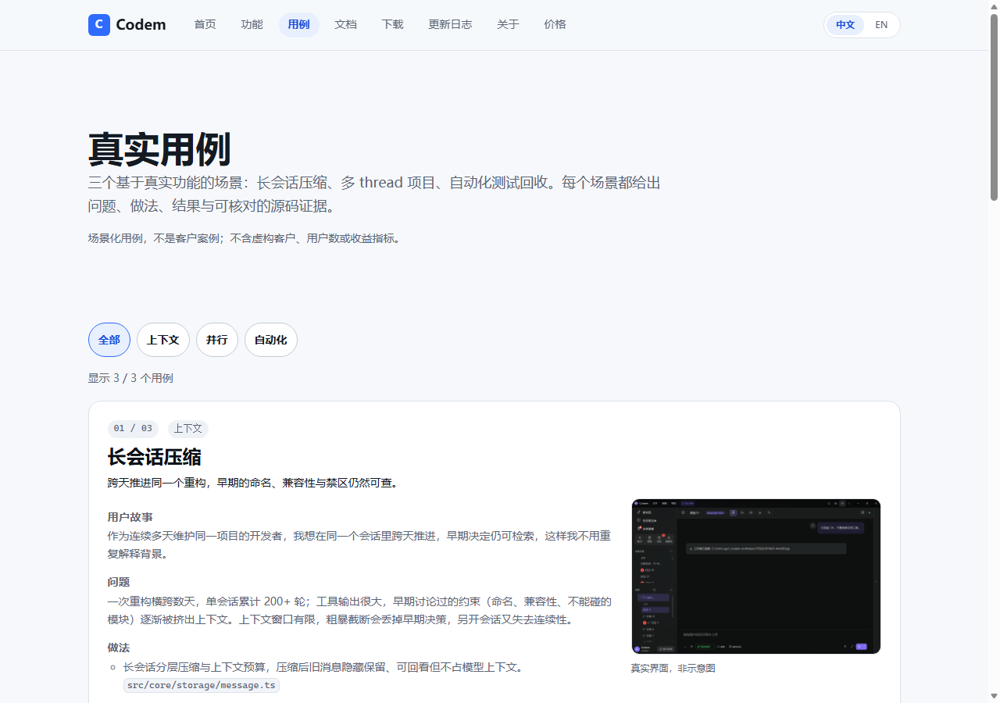
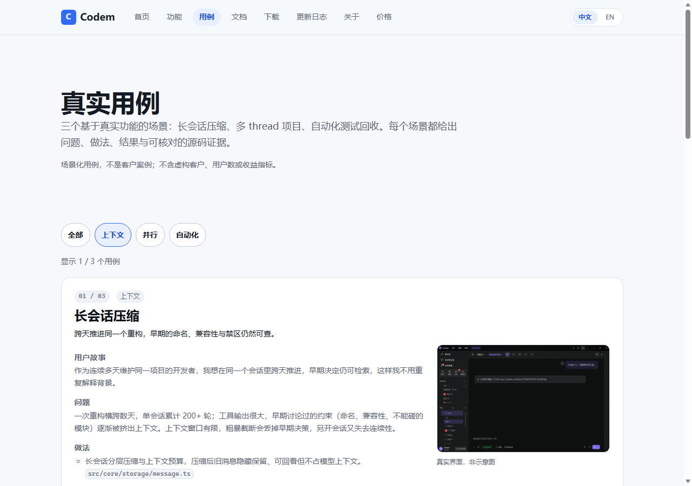
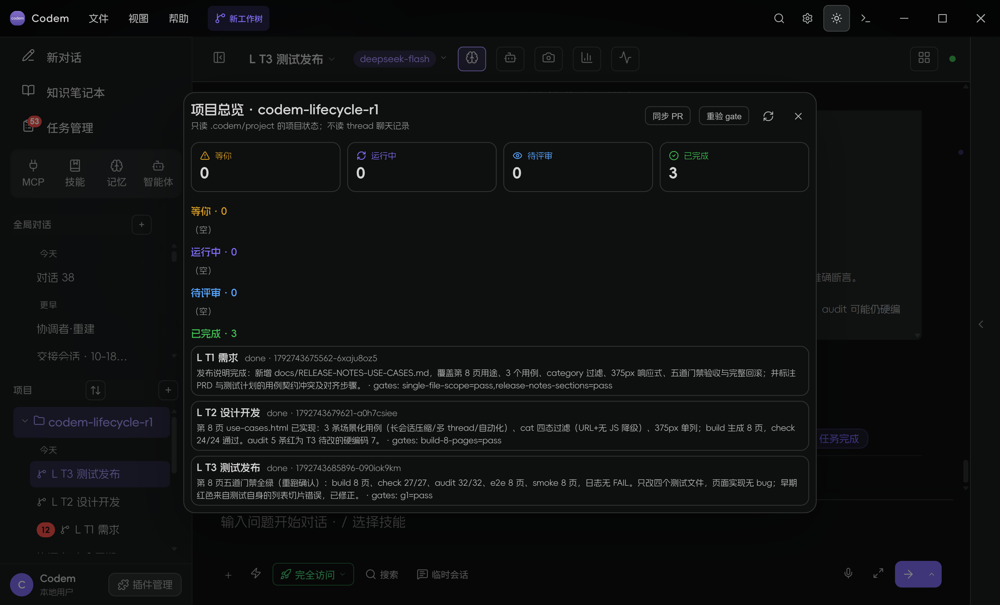
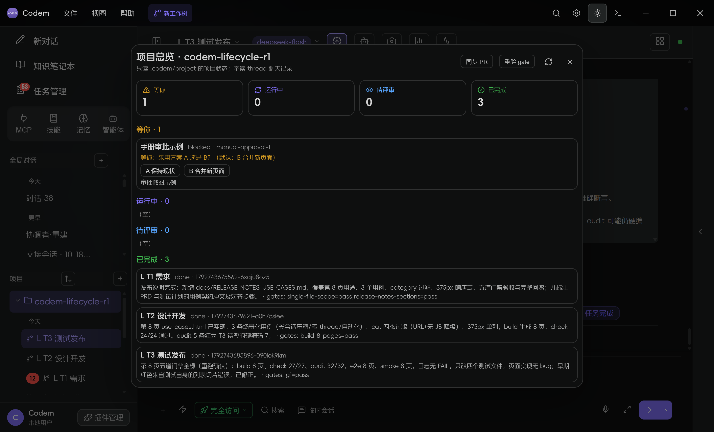
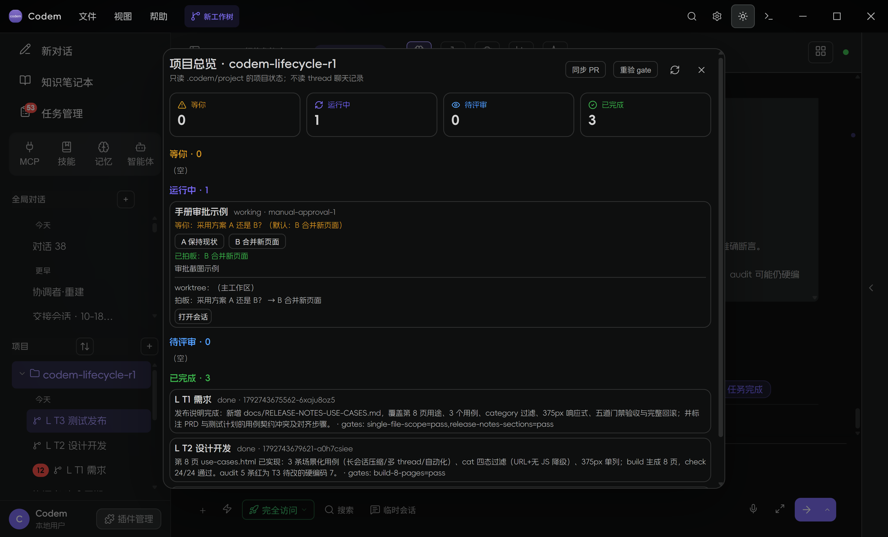

# Codem 类 Project 模式实战手册

> 用「Codem 官网第 8 页」这个真实项目，从需求、设计、开发、测试到发布走一遍。
> 本手册不是概念介绍，所有截图、路径、报告和命令都来自本仓库里的真实执行。

- 真实项目：`<repo>/.preview-shot/coordinator-lab/site-lifecycle-r1`
- 项目名：`codem-lifecycle-r1`
- 3 个 thread：`L T1 需求`、`L T2 设计开发`、`L T3 测试发布`
- 最终交付：官网第 8 页 `site/use-cases.html`（真实用例库）
- 最终门禁：`build`、`check`、`audit`、`e2e`、`smoke` 全绿
- 证据日志：`.codem/evidence/lifecycle-gates.log`
- 新增文档：PRD、设计规格、测试计划、发布说明（见文末清单）

---

## 0. 先理解：类 Project 模式到底在管什么

Codem 的 Project 模式不是“给会话改个名字”，它把一次交付拆成四层：

```text
项目（repo + .codem/project）
  ├─ brief / MEMORY / gates          ← 项目级事实与验收口径
  ├─ 协调者会话                       ← 拆解、派活、收口
  ├─ thread 会话 + git worktree       ← 每个任务独立目录/分支
  └─ project_report + gate-checks     ← 完成必须带证据，不能口头说完成
```

三个关键纪律：

1. **thread 只在自己的 worktree 里改代码**，不直接改主工作区；
2. **报告说 done 不算完**，gate 必须能重跑通过；
3. **协调者收口**：合并、解冲突、重验 gate、更新 Overview。



上图就是本用例的真实侧栏：项目 `codem-lifecycle-r1` 下有三个 thread，当前打开的是协调者会话。

---

## 1. 准备

最低要求：

- Codem 已安装并登录模型；
- 电脑有 Git（worktree 依赖 Git）；
- 一个空目录或已有仓库，作为项目根目录。

本用例用的是官网仓库的干净克隆：

```powershell
git clone <官网仓库> site-lifecycle-r1
cd site-lifecycle-r1
git status --short   # 必须干净
```

> 为什么要干净：thread 创建 worktree 时会以当前 HEAD 为基线；工作区有未提交改动时，worktree 里看不到它们，容易出现“我明明改了”的错觉。

---

## 2. 创建项目

在左侧「项目」区点 `+`，选择项目目录，填项目名。

创建后项目目录下会出现：

```text
.codem/
  project/
    state.json          # 项目 + thread 注册表
    brief.md            # 项目目标/约束/验收
    MEMORY.md           # 跨会话项目记忆
    gates.json          # gate 定义
    events.jsonl        # 项目事件
    reports/            # 每个 thread 的 project_report
    gate-checks.json    # gate 重跑结果
    decisions.jsonl     # 审批拍板记录
```

`state.json` 是 thread 注册表的唯一真相；不要手改它来“补一个 thread”，否则会话和 worktree 会对不上。

---

## 3. 写 brief：把“做什么”固定下来

新建项目后先写 `brief.md`。本用例的真实 brief 节选：

```markdown
## 目标

用 Codem 官网做一次真生命周期：需求 → 设计 → 开发 → 测试 → 发布说明，
最终上线第 8 个页面 use-cases.html（真实用例库）。

## 新功能

- 新页面 use-cases.html：3 个真实工作流用例；
- 每个用例：标题、场景、步骤、结果指标、关联能力；
- 顶部可按 category 过滤；
- 响应式 375px；SEO title/description/sitemap；导航第 8 项。

## 硬验收

- 8 页 / 8 个导航项；新页面 3 个用例、过滤可用、375px 不溢出；
- build、check、audit、e2e、smoke 全绿；
- 3 个 thread 各自写 project_report；所有改动合并回主工作区。
```

brief 不是写给人看的装饰：协调者和 thread 的系统提示会读它，gate 也会用它做页面数等断言。

---

## 4. 建协调者并拆解

项目菜单 →「新建协调者对话」，得到 `协调者·生命周期`。

协调者的职责不是自己写全部代码，而是：

1. 读 brief，拆成 3 个可并行的任务；
2. 给每个 thread 建会话 + worktree；
3. 收报告、看证据、合并；
4. 冲突时拍板；
5. 重验 gate，更新 Overview。

拆解示例（本用例实际拆法）：

| thread | 负责 | 产物 |
|---|---|---|
| L T1 需求 | 用户故事、验收标准、非目标 | `docs/PRD-USE-CASES.md` |
| L T2 设计开发 | 布局、组件、响应式、实现 | `docs/DESIGN-USE-CASES.md` + `site/*` |
| L T3 测试发布 | 测试计划、五道门禁、发布说明 | `docs/TEST-PLAN-USE-CASES.md` + 门禁更新 |

> 并发上限按机器自动取 1 / 2 / 3；本机是 3。超过上限会被拒绝，不会把机器压死。

---

## 5. 建 thread 与 worktree

在每个 thread 的会话上右键，或用项目菜单建会话，然后给会话绑定 worktree。

本用例的真实 worktree 路径：

```text
site-lifecycle-r1/.codem-worktrees/1792743675562-6xaju8oz5   # L T1
site-lifecycle-r1/.codem-worktrees/1792743679621-a0h7csiee   # L T2
site-lifecycle-r1/.codem-worktrees/1792743685896-090iok9km   # L T3
```

检查：

```powershell
git worktree list
```

每个 thread 的会话标题旁会显示 worktree 标识；改动只出现在它自己的目录里。

---

## 6. 阶段 A：先出三份“纸面产物”

不要一上来就让三个 thread 同时写代码。先把需求、设计、测试计划分开做，能提前暴露契约冲突。

### 6.1 给 T1 的 prompt（真实使用）

```text
只做需求阶段：新建 docs/PRD-USE-CASES.md，为 Codem 官网新增第 8 页
use-cases.html（真实用例库，3 个用例：长会话压缩/多 thread 项目/自动化测试回收；
支持 category 过滤；375px 响应式）。写清用户故事、功能需求、验收标准、非目标。
只改这一个文件。完成后调用 project_report：status=done，summary 写 PRD 完成，
evidence kind=log ref=docs/PRD-USE-CASES.md，changes 写该文件。不要委派。
```

### 6.2 给 T2 的 prompt

```text
只做设计阶段：新建 docs/DESIGN-USE-CASES.md，为第 8 页 use-cases.html 定义
布局、组件结构、空态/过滤态、375px 响应式、复用现有 tokens.css/site.css 的令牌与类。
不要写实现代码。只改这一个文件。完成后 project_report...
```

### 6.3 给 T3 的 prompt

```text
只做测试计划阶段：新建 docs/TEST-PLAN-USE-CASES.md，针对新增第 8 页写测试计划：
8 页/8 导航、3 个用例、category 过滤、375px、SEO/sitemap、五道门禁要改哪些文件与断言。
先不要改实现/门禁代码。只改这一个文件。完成后 project_report...
```

### 6.4 收报告

三份文档实际大小：

```text
docs/PRD-USE-CASES.md         24,068 bytes
docs/DESIGN-USE-CASES.md      16,324 bytes
docs/TEST-PLAN-USE-CASES.md   14,344 bytes
```

报告不是“我完成了”，而是：

```json
{
  "report_id": "...",
  "thread_id": "...",
  "status": "done",
  "summary": "PRD 完成：新增 docs/PRD-USE-CASES.md ...",
  "evidence": [{ "kind": "log", "ref": "docs/PRD-USE-CASES.md" }],
  "changes": ["docs/PRD-USE-CASES.md"]
}
```

`evidence` 指向真实文件；`changes` 指向真实改动。没有证据的 done 会在 Overview 里进「待评审」。

---

## 7. 阶段 B：实现第 8 页

T2 在自己的 worktree 里改这些文件：

```text
site/pages.mjs             # 页面清单：7 → 8，nav 自动跟随
site/build.mjs             # 生成 use-cases.html
site/use-cases-data.mjs    # 新增：3 个用例数据
site/site.css              # 页面布局/过滤条/卡片/375px
site/site.js               # category 过滤（URL + 无 JS 降级）
brief/PROJECT.md           # 页面数 7 → 8
docs/ia.md                 # 信息架构 7 → 8
memory/M5.md               # 页面数决策
```

关键点：**页面数只在 `pages.mjs` 改一处**，build / check / e2e / smoke 都从它推导；不要在测试脚本里写死 8。

真实构建输出：

```text
[build] wrote use-cases.html (23159 bytes)
[build] done: 8 pages, 5 assets, version 1.16.329 ...
```

### 桌面端



### 375px 移动端


### category 过滤

URL 参数 `?cat=context` 也能直接进入过滤态：



过滤行为：

- 4 个 chip：全部 / 上下文 / 并行 / 自动化；
- 显示 `1 / 3` 这类计数；
- 空态有 `[data-filter-empty]` 提示；
- URL 同步 `?cat=`，刷新后保持；
- 无 JS 时三张卡片仍然全部可见（渐进增强）。

---

## 8. 测试：五道门禁必须真跑

T3 在自己的 worktree 里改测试脚本，不改页面实现：

```text
site/check.mjs   # 27 项：8 页、3 用例、过滤、375px、SEO
site/audit.mjs   # 32 项：brief/ia/memory、sitemap、页面契约
site/e2e.mjs     # 真实浏览器：8 页、a11y、375px、体积预算
site/smoke.mjs   # 生产静态服务：8 页、安全头、404、SEO
site/build.mjs   # 构建本身
```

在本用例主工作区重跑：

```powershell
cd .preview-shot/coordinator-lab/site-lifecycle-r1
node site/build.mjs
node site/check.mjs
node site/audit.mjs
node site/e2e.mjs
node site/smoke.mjs
```

真实结果：

```text
[check] 27/27 checks passed
[audit] 32/32 checks passed
PASS E2E 8 页 / SEO / a11y / 375px / 预算 全部通过（CSS 33361B, JS 5877B）
PASS SMOKE 8 页 + 资产 + SEO + 安全头 + 404 全部通过
```

完整输出保存在：

```text
.codem/evidence/lifecycle-gates.log   （26 KB，逐项 PASS + EXIT=0）
```

报告里的 gate 长这样：

```json
{
  "id": "g1",
  "passed": true,
  "verified_by": "command",
  "evidence_ref": ".codem/evidence/lifecycle-gates.log",
  "command": "node site/check.mjs"
}
```

### 为什么还要「重验 gate」

报告里的 `passed: true` 只是 thread 自己说的。Overview 会显示：

```text
4 个 gate 未重验（报告说通过不算，点「重验 gate」）
```

点「重验 gate」后，Codem 在项目工作区真的执行报告里的命令，结果写 `gate-checks.json`；只有命令 exit 0 的 gate 才算 verified。

本用例重验后 Overview：



```text
等你 0 / 运行中 0 / 待评审 0 / 已完成 3
```

---

## 9. 审批：blocked 报告与拍板

当 thread 需要人拍板时，报告写 `status: "blocked"`：

```json
{
  "status": "blocked",
  "blocking": {
    "question": "采用方案 A 还是 B？",
    "options": ["A 保持现状", "B 合并新页面"],
    "default": "B 合并新页面"
  }
}
```

Overview 会把它放进「等你」，并显示可点选项：



点「B 合并新页面」后：



状态从 `waiting` → `working`，同时写 `decisions.jsonl`：

```text
拍板：采用方案 A 还是 B？ → B 合并新页面
```

> 审批不是装饰：thread 的下一轮会读到这个决定，不需要你再去聊天里重复一遍。

---

## 10. 合并与冲突

正常合并：

```powershell
# 在项目主工作区
git worktree list
git merge <thread-branch> --no-edit
```

Codem 的「合并 worktree」按钮做的是同一件事；合并后主工作区应该能直接 build。

冲突时会出现类似横幅：

```text
合并冲突，已回滚主工作区；冲突文件: site/README.md
```

处理顺序：

1. **不要慌着点第二次合并**；先看冲突文件；
2. 打开 worktree 里的版本和主工作区版本，决定保留哪边；
3. 在项目主工作区手动解冲突，`git add`，`git commit`；
4. 重新跑五道门禁；
5. 在 Overview 点「重验 gate」。

本仓库演练过的真实冲突是 `site/README.md`：T2 和主工作区都改了 README。最终选择保留 T2 的章节，再补主工作区内容，重新跑 gate 通过。

> 经验：文档类冲突优先保留 thread 的版本，再追加主工作区独有段落；代码类冲突必须以 gate 为准，不以“看起来对”收口。

---

## 11. 自动化

任务中心 → 自动化触发器，可以配置：

- cron / 文件变化 / Issue 触发；
- 命中后自动新建会话执行任务；
- 结果进收件箱或任务中心。

注意：

- 触发器创建后要确认「已启用」；
- 运行中的触发器新增后，不需要重启 Codem，下一次命中就会建会话；
- 自动化会话和普通会话一样受并发上限约束；
- 失败结果要保留在收件箱，不要只看“已触发”。

---

## 12. 回收：会话、worktree、进程

### 删除会话

删除运行中的会话时，Codem 会先 abort loop，再删数据：

- 不应出现 `FOREIGN KEY constraint failed`；
- 不应出现“数据保存失败”横幅；
- thread 注册表要同步移除，不能留下幽灵会话。

本用例真机验证过：删除运行中的 `ping` 会话，无 FK、无跨会话写入；`ping` 子进程在命令自身结束后退出。

### 清理 worktree

```powershell
git worktree list
git worktree remove .codem-worktrees/<session-id>
git branch -D codem/<session-id>   # 确认已合并后再删
```

### 检查残留

```powershell
Get-Process codem -ErrorAction SilentlyContinue
Get-NetTCPConnection -LocalPort 1420 -State Listen -ErrorAction SilentlyContinue
```

测试结束应无 Codem、无 1420、无测试浏览器。

---

## 13. 复现清单

```powershell
# 1. 项目
cd .preview-shot/coordinator-lab/site-lifecycle-r1
git status --short

# 2. 三份纸面产物
Get-Item docs/PRD-USE-CASES.md, docs/DESIGN-USE-CASES.md, docs/TEST-PLAN-USE-CASES.md

# 3. 第 8 页
Get-Item site/use-cases-data.mjs, site/dist/use-cases.html

# 4. 五道门禁
node site/build.mjs
node site/check.mjs
node site/audit.mjs
node site/e2e.mjs
node site/smoke.mjs

# 5. 证据
Get-Content .codem/evidence/lifecycle-gates.log -Tail 30
```

预期：

```text
8 pages
27/27 checks
32/32 audit
PASS E2E 8 页
PASS SMOKE 8 页
```

---

## 14. 本用例的完整产物

| 产物 | 路径 |
|---|---|
| PRD | `docs/PRD-USE-CASES.md` |
| 设计规格 | `docs/DESIGN-USE-CASES.md` |
| 测试计划 | `docs/TEST-PLAN-USE-CASES.md` |
| 发布说明 | `docs/RELEASE-NOTES-USE-CASES.md` |
| 页面数据 | `site/use-cases-data.mjs` |
| 页面模板/构建 | `site/build.mjs`、`site/pages.mjs` |
| 样式/交互 | `site/site.css`、`site/site.js` |
| 构建产物 | `site/dist/use-cases.html` |
| 门禁日志 | `.codem/evidence/lifecycle-gates.log` |
| 桌面截图 | `docs/manual/images/05-use-cases-desktop.png` |
| 移动截图 | `docs/manual/images/06-use-cases-mobile.png` |
| 过滤截图 | `docs/manual/images/07-use-cases-filter.png` |
| 项目总览 | `docs/manual/images/02-overview.png` |
| 审批截图 | `docs/manual/images/03-approval-waiting.png`、`04-approval-working.png` |

3 个 thread 的最终报告：

```text
reports/1792743675562-6xaju8oz5-*.json   # L T1
reports/1792743679621-a0h7csiee-*.json   # L T2
reports/1792743685896-090iok9km-*.json   # L T3
```

---

## 15. 常见问题

**Q：为什么 thread 里看不到 `delegate_to_session` / `wait_for_delegation`？**
项目 thread 默认隐藏委派与交接工具，避免简单任务进入“等委派”死循环。协调者才负责拆解。

**Q：为什么 3 个 thread 同时跑会有一个排队？**
并发上限按机器取 1 / 2 / 3；超过上限是拒绝而不是排队。先收一个再发下一个。

**Q：报告说 done，为什么 Overview 显示待评审？**
gate 没全过、没有登记 gate、或 gate 没重验。点「重验 gate」，让命令真跑。

**Q：开发模式启动很慢？**
`tauri dev` 的 Vite 模块图冷加载会到 60 秒以上；安装版页面本身约 1 秒级。不要在 dev 启动耗时上判断产品性能。

**Q：worktree 里的改动主工作区看不到？**
正常。先合并 worktree，或在主工作区 `git merge` 对应分支。

**Q：冲突后主工作区被回滚了？**
Codem 为避免半合并状态会回滚；冲突文件仍保留在 worktree。按第 10 节手动解冲突再合并。

---

## 16. 一句话总结

> **Project 模式的核心不是“多开几个会话”，而是：brief 固定目标、thread/worktree 隔离改动、report 带证据、gate 真跑、Overview 收口。**
>
> 这五件事任何一件偷懒，最后都会变成“看起来完成了，但成果不在”。

