# 13 · UI/UX 对标：OMP Studio vs Codem（可验收优化方案）

> 基线：Codem 1.16.330（2026-10-26）｜ OMP Studio 0.1.10（`main` @ `6c82315`）
> 方法：**真实运行 + 源码取样 + computed style + 截图对照**，不是只看参考图。
> 证据目录：[`docs/evidence/ui-benchmark-omp-2026-10-26/`](../evidence/ui-benchmark-omp-2026-10-26/README.md)

---

## 0. 先说结论

OMP Studio 的 UI 之所以“看起来漂亮”，不是因为它用了更多特效，而是因为**一套很克制、贯穿所有元素的视觉语法**：

- **一个强调色**（lilac），**一套中性灰阶**，**一条 2px 间距阶梯**；
- **6 / 9 / 12 / 16 四档圆角**，**1px 边框**，**静态面板不用阴影**；
- **12px 界面字 / 14px 正文 / 16px 标题**，层级靠字重与留白，不靠字号乱跳；
- **44px 顶栏 + 272px 侧栏 + 480px 右栏 + 768px 文档列 + 240px 底栏**，所有屏幕共用同一组布局常量；
- **每个交互只有一个焦点指示**，输入框是柔光、按钮是 2px outline、菜单是边框；
- **所有“操作”都有稳定的位置**：页头导航、右栏页签、底栏页签、Composer 工具栏；
- **细节有物理感**：按钮按下 `translateY(1px)`，菜单从 `-3px` 进入，页切换上浮 12px，树行悬停时文件名渐隐让位给操作按钮。

Codem 的功能比 OMP 多得多（23 个设置分区、任务中心、知识笔记本、记忆、手机/微信、三套皮肤），**不应该照搬 OMP 的页面 IA**。但 Codem 目前的“视觉语法”是**多套并存**的：composer 是透明直角色块 + 重阴影，settings 是 760px 弹窗 + 20% 紫选中（比 OMP 的 14% 更重），消息是 907px 宽文档 + 大号标题，树是 28px 行 + 彩色 pill 徽章，工具是每张都带边框的卡片。每一处单看都还行，合起来就“不够贵”。

**本方案的目标不是变成 OMP，而是把 Codem 收敛成一套自己的、同样克制的语法。** 优先级：

1. **P0（先做，风险低、观感提升最大）**：Composer 卡片化、文档宽度收窄、暗色 token 提亮、静态面去阴影、焦点单环、设置选中态变柔、聊天内标题降级、三皮肤 token 对齐、用户气泡保留原版。
2. **P1（组件级）**：命令面板、模型角色菜单、侧栏/文件树密度、工具行、设置分组行、菜单/弹层、空态。
3. **P2（布局级，需产品拍板）**：设置从弹窗改为整页、右侧 Inspector 常驻、底部面板、页面级导航。
4. **P3（持续）**：三皮肤 token 对齐、对比度、动效、截图契约。

### 0.1 如果只做 10 件事

| # | 改动 | 为什么 | 验收 |
|---|---|---|---|
| 1 | Composer 变成 820 宽、14px 圆角、surface 底、无阴影、无内线 | 当前最像“工具条”，不是“输入卡” | 空/运行/焦点三态截图；computed 断言 |
| 2 | 正文列 820；系统消息改左轨行（标题 16/15/14 留给 P0-6） | 907px + 20px h1 让聊天像网页 | 长消息截图；行宽/标题对照 |
| 3 | 暗色边框 .14→**.12**，文字 #d4d4d4→#e6e7ea | 去“黑框套黑框”，提阅读对比；9% 会低于 DARK-UI-4 的 1.4:1 下限 | 对比度脚本 + 主界面截图 |
| 4 | 焦点单环：保留 188/189 轮验收过的 `.input-textarea-row` 2px 环（不移到卡上）；其余 2px outline | 现有双环/常亮历史 | Tab 20 控件无“双环” |
| 5 | 设置 active 20%→14%、34→30；行组卡片化延后 | 选中态厚重、内容散 | 设置页截图；行组圆角（下一轮） |
| 6 | 命令面板改命令中心（分组/导航/快捷键） | 现在只是“项目搜索” | 四组命令截图；键盘可达 |
| 7 | 模型菜单按角色分组 + 选中 check + 隐藏未知 | 现在是 10 行模型名 + `【未知】` | 首屏 ≤7 行；每行三要素 |
| 8 | 侧栏/树密度：260 / 34 / 30 / 26；Git 字母 | 现在偏大、pill 吵 | 40 行滚动；hover 截图 |
| 9 | 工具去“每张卡”边框，改行 + 状态轨 | 连续调用像一叠盒子 | 5 个工具连续截图 |
| 10 | 用户气泡保留原版半透明紫 + 轻阴影 | 用户 review：原版比 OMP 实底更精致 | 与原版截图并排；暗/亮/三皮肤对比度 |
| 11 | 思考块对齐 **DSH 的单行 ReasoningRow**，不是 OMP 的多卡 | OMP 是 per-think 分段卡；DSH 是单行 + 段落摘要 | 折叠 24px 固定高、流式段落首行、展开分块 body；不按空行伪造分段 |

### 0.2 HTML 预演验证（2026-10-26）

> 先按 P0 + P1 做了一版可运行的 HTML，再拿它和 OMP 实拍对照；**下面这些是对原方案的修正**，不是补充说明。
> 文件：[`docs/design/ui-benchmark-mock.html`](../design/ui-benchmark-mock.html)
> 预览：[dark](../design/ui-benchmark-mock-dark.jpg) / [light](../design/ui-benchmark-mock-light.jpg) / [settings](../design/ui-benchmark-mock-settings.jpg) / [cmdk](../design/ui-benchmark-mock-cmdk.jpg)

| 预演结论 | 对方案的修正 |
|---|---|
| 1600 宽下 `260 + 820 + 400` 成立；正文 820 不挤，右栏 400 够放 Changes/检查/预览 | 右栏目标从 420–460 收到 **400**；1440 宽右栏 360、正文 780；**≤1280 隐藏右栏**；≤900 隐藏侧栏 |
| Composer 820×112（带上下文 chips）看起来成立；再加 36px queue dock 后，与 OMP 的 composer + task dock 总高度接近 | Composer 目标 **112–124**，不是无限压到 96；chips 只在有上下文时显示；queue 贴 Composer 上方 |
| 用户 review：**原版半透明紫**比 OMP 实底更精致 | **保留 `--message-bubble-user` 15%/25% + 轻阴影**；不采用 OMP 实底；补 24px 用户头像 |
| 设置整页（左 220 + 内容 900）成立，但**没有 OMP 的全局页头**，看起来像独立页面 | 设置整页保留 back + 标题，**不复制 OMP 的 10 项全局 nav**；P2 先做 A/B，不通过就退回 900px 弹窗 |
| 模型菜单 9 个角色放在 340×500 会盖住半屏；OMP 的 9 个角色约 420 高 | 菜单 **340×460**，**最多 7 行可见 + 内部滚动**；`@tag`/模型/强度三要素保留 |
| 命令面板 660×600、4 组 13 条能放完；OMP 是 6 组可滚动 | 首屏保证 **4 组（最近/推荐/页面/面板）**；配置与项目组按高度追加，不为了“像 OMP”硬塞 |
| 侧栏加文件树后密度明显变好；但会和右栏“文件”重复 | **项目会话**侧栏保留文件树；右栏只做 Changes/检查/预览，不再做第二棵树 |
| 默认 34px 底栏偏空；展开 190px 终端后整体接近 OMP，但会挤掉摘要卡 | 底栏默认 **collapsed 34**；终端按需展开 **190**，不做 OMP 的常驻 240 |
| 聊天头只有标题/模型时顶部发空 | 加 **`12 轮 · 42% 上下文 · main`** 10.5px 元信息；窄屏隐藏 |
| 工具行 + 左状态轨成立，但代码面板与卡片同色会糊 | 代码面板用 `--surface-2`，工具行用 `--surface`；不要加外框 |
| 暗色 `#101318` 比 OMP `#121519` 还黑一档 | 保留 `#101318` 作为 Codem 底色；如果实拍仍偏黑，再试 `#111419`，不要直接复制 OMP |
| 设置 active 14% 在暗色成立；20% 明显成块 | P0-5 的 14% 保持；**删掉被覆盖的旧实心规则** |
| Codem 的 `message.reasoning` 是**一整段**，OMP 的 `ThinkCard` 是 per-think 时间线卡 | **最终不做分段卡**：P1-6 对齐 DSH 单行（段落级摘要 + 固定 24px 折叠 + 展开分块 body）；不改数据模型 |

**预演没有解决的问题**（不要假装已经解决）：

- OMP 的底部 240 面板、顶部页面导航是它 IA 的一部分；Codem 只做“按需底栏 + 返回式设置页”，不照搬。
- OMP 侧栏 272 / 右栏 480 的比例来自它 768 文档列；Codem 820 文档列下用 400 右栏更稳。
- 预演是静态 HTML，不能证明真实组件的滚动、虚拟列表、焦点陷阱、IME、拖拽；这些必须在 Phase 0 用真机 CDP 验。

### 0.3 第二轮深度复查：状态、IA 与可访问性

> 触发：用户 review 指出“用户消息原版这个紫色更精致”。这说明第一轮把 OMP 的**实底气泡**当成目标，属于**过度对标**。第二轮不再只改颜色，补上第一轮没覆盖的状态、IA、键盘、DPI、代码阅读与性能问题。

#### 0.3.1 立即修正：用户气泡保留 Codem 原版半透明紫

- 原版令牌：暗色 `--message-bubble-user: rgba(124,108,240,.15)`、`--message-bubble-user-border: rgba(124,108,240,.25)`、`--shadow-bubble: 0 1px 3px rgba(0,0,0,.2)`；亮色 `.08/.16` + 极轻阴影。
- **结论：不采用 OMP 的实底 accent 气泡。** Codem 的半透明紫 + 细边 + 轻阴影更精致，也更适合中文正文；OMP 实底只适合它自己的对比体系。
- 预演直接用原版 `.15/.25`，不再为了看清而 +5%；真机实拍如果确实偏暗，再以 +3% 为上限微调。
- 保留 24px 用户头像（原版 `user-msg-avatar`）、14/14/4/14 圆角、10/16 内边距、14px 正文字号。
- 不再新增 `--bubble-bg/--bubble-text` 实底 token；只保留/微调现有 `--message-bubble-user*`，避免两套气泡语义。

#### 0.3.2 状态矩阵：第一轮只做了“默认 + running”

| 状态 | 视觉反馈 | 现有实现（不要重写） | 验收 |
|---|---|---|---|
| 空会话 | 欢迎语 + 快捷入口 + 输入焦点 | `ChatPanel` empty-state / quick access | 不显示空白大页；输入框自动聚焦 |
| 历史加载 / 不可用 | 骨架或状态行 + 重试 | `messages-loading` / `messages-unavailable` | 不闪“空会话”；可重试 |
| 流式：connecting / receiving / tools | 状态行 + 计时 + 停止按钮；正文光标 | `StreamingTimer` / `StreamingWaitIndicator` / cancel | 三阶段文案不同；停止可立即取消 |
| 思考块：collapsed / streaming / expanded | 段落级摘要 + 字数 + 展开全文 + 光标；折叠固定 24px；历史默认折叠 | `ReasoningRow`（单块 `message.reasoning`） | 不逐字符横向抖；展开后不每帧重置滚动；不伪造分段 |
| 等待审批 | 行内审批卡或弹窗；风险色 + 允许一次/始终/拒绝 | `PermissionPresetSelector` / approval 逻辑 | 不把“待审批”演成“运行中”；Esc 不误放行 |
| 队列 / guidance | Composer 上方 36px dock；可编辑/删除 | `guidanceMessages` / queue | 无队列时**不显示** dock |
| 工具 running / done / error | 左状态轨 + 文案 + 图标；错误可展开 | `ToolCallCard` / `toolStatus` | 不只靠颜色；错误有重试/复制 |
| 回合完成 / 错误 | 完成行或 ErrorCard；不假装成功 | `ErrorCard` / turn footer | 失败不显示“任务完成” |
| 断线 / 重连 | 顶部状态条 + 禁用发送 | `connection-lost` banner | 不丢当前草稿；重连后恢复 |
| Composer：focus / IME / drag / attachment / disabled | 单环、组合输入、拖拽遮罩、附件 chip、禁用提示 | `compositionJustEndedRef` / `isDragOver` / `blurFolded` | 中文回车不误发；拖拽不闪 |
| 命令面板：空 / 无结果 / 加载 | 空态文案 + 清除搜索 | `cmdk`（新建） | 不显示空白列表 |
| 设置：搜索无结果 / 保存失败 | 空态 + “未确认保存” | `settingsSearch` / `saveFailure` | 不把失败演成“已保存” |
| 模型菜单：无模型 / 未知 | 空态 + “配置 Provider”入口 | `model-picker` | 不铺 10 行 `【未知】` |

**执行要求**：每个新组件至少覆盖 **default / hover / focus-visible / disabled / loading / error / empty** 七态中的相关项；不能只交一张静态主图。

#### 0.3.3 设置 IA：23 个分区不能压成 8 个平铺项

`SettingsPanel.tsx` 现有 **23 个 tab**；`SETTINGS_TAB_INDEX` 只索引了 22 个，**漏了 `memory-checkup`（记忆体检）**，搜索找不到。整页化前必须先修这个索引，否则“搜索设置”会继续漏项。

建议的两级 IA（左 8 组，右组内 2–5 个 tab）：

| 左组 | 组内 tab |
|---|---|
| 通用与外观 | general、appearance |
| 模型与运行 | ollama、multimodal、voice |
| 对话与知识 | knowledge、persona、memory-checkup |
| 工具与权限 | security、tools、computer |
| 连接与设备 | git、environment、worktree、wechat、phone |
| 自动化与统计 | automation、performance、usage |
| 实验与扩展 | codegraph、pet、advanced |
| 帮助 | help |

- 左组只负责“找方向”；右侧用 26px 子导航 pills 切换具体 tab；搜索仍直接跳到 tab，并自动展开所属组。
- **保留显式保存**（现有 `handleSave` + `saveFailure`），不要改成自动保存；整页底部固定保存栏，失败必须显示“未确认保存”。
- 如果产品不接受整页：退回 **900px 弹窗**，同样使用两级 IA；不要把 23 项硬塞进 760px 单列。

#### 0.3.4 键盘 / IME / ARIA

- **焦点陷阱**：命令面板、设置页、模态打开时把焦点移入；Esc 关闭后**还给触发按钮**；Tab 不逃逸。
- **快捷键**：`Ctrl+K` 命令面板、`Ctrl+B` 侧栏、`Ctrl+J` 底栏、`Ctrl+,` 设置、`Esc` 关闭最上层；不要和输入框冲突。
- **IME**：输入法组合期间 Enter 不能发送。现有 `compositionJustEndedRef` + `nativeEvent.isComposing` 已修过，改 Composer 时**不得删/绕过**；验收要真打中文。
- **ARIA**：palette `role=dialog aria-modal`；设置页签 `aria-selected`；树 `aria-selected`；流式/审批/toast 用 `aria-live=polite`；图标按钮要有 `aria-label`。
- **目标尺寸**：24px 下限；树行 22px 图标用伪元素扩热区；不要只靠 hover 才可操作。

#### 0.3.5 视口 / DPI / 密度

| 维度 | 必测 |
|---|---|
| 视口 | 1280×800、1440×900、1600×1000、1920×1080、2560×1440 |
| 缩放 | 100% / 125% / 150% / 200% |
| 密度 | compact 0.85 / standard 1 / cozy 1.15 |
| 极端内容 | 超长无空格 URL、长中文标题、20 行表格、200 行工具输出 |

- 125% 下 1px 边框可能“消失”，不要用 0.5px；2px 焦点环必须仍然完整。
- 密度只缩间距/控件，不缩字号；compact 下控件不低于 24px。
- 2560 宽不能把正文拉成 1400；仍以 820 为上限。

#### 0.3.6 字体与中文排版

- Alimama 方圆体是品牌资产，但必须有 **`font-display: swap` + Segoe UI/微软雅黑 fallback**；字体未加载时正文不能从 14 掉到 13、行高不能跳。验收：禁用字体文件后截图，布局偏移 ≤1px。
- 中文正文 14px / 1.7；界面 12–13；元信息 **不低于 11px**（10.5 只用于数字/英文标签，不用于中文句子）。
- 时间、token、费用用 `font-variant-numeric: tabular-nums`；不要把 560 字重当唯一层级（fallback 字体可能没有 560，会回落到 400/700）。
- 长 URL/路径用 `overflow-wrap:anywhere` + 横向滚动，普通中文段落用 `text-wrap: pretty`；不要全站 `word-break: break-all`。
- 代码 12px / 1.7，行号 10.5 mono；中文注释与代码同宽，不额外缩小。

#### 0.3.7 对比度 / 三皮肤

- 目标：正文 ≥7:1；次要 ≥4.5:1；弱文字 ≥4.5:1；禁用 ≥3:1；accent 上的文字 ≥4.5:1。
- **Dream 的 6 个缺失 token（success/warning/error/info/dropdown-bg/text-on-accent）必须在新组件之前补齐**；否则 P1 的 Composer/设置会先在 Dream 里坏掉。这是顺序问题，不是 P3 收尾。
- Hub 橙色 active/警告色要单独测；不要用“橙色文字 + 浅橙底”低于 4.5。
- 不只靠颜色：diff 用 +/−，Git 用字母，状态用图标/文字。

#### 0.3.8 代码 / Diff / 表格

- 代码块：12px / 1.7，最大高 360，头部 sticky，复制/换行切换，横向滚动不撑破文档列。
- Diff：行高 18–20，+/- 双通道；新增/删除底色不超过 10%；长行横向滚动；不整页横向溢出。
- 表格：12px，表头 11/600，行高 32，sticky 表头，横向滚动；不要斑马纹 + 外框 + 阴影三层。
- Markdown 标题仍按 16/15/14；代码内的标题不参与。

#### 0.3.9 Composer / 面板的条件状态

- queue dock **只在有队列时显示**；summary card **只在本轮有摘要时显示**。预演为了展示一直显示，落地必须条件渲染。
- 流式中发送按钮变“停止/排队”双态；空输入禁用；附件 chip 可删；拖拽有遮罩；错误在输入区内联提示，不弹大 toast。
- 右栏/底栏的拖拽手柄 4px、双击复位、键盘可调；折叠状态持久化；底栏 34/190，不做常驻 240。
- 右栏不再放第二棵文件树；Changes / 检查 / 预览三块即可。

#### 0.3.10 性能与实现约束

- `styles.css` 已 21.5k 行；每阶段新增 CSS **≤300 行**，优先改现有块，不复制一套新组件样式。
- 不新增 `!important`（当前基线 50 处）；不新增硬编码颜色（scan-ui 会抓）；不写 `transition: all`。
- 消息列表已有 `content-visibility`；不要给每条消息加阴影/模糊/大面积 `backdrop-filter`。
- 不引入新依赖；截图/契约用现有 Edge CDP + Node WebSocket。
- 每阶段产物：代码 + 截图 + computed 契约 + 体积/行数变化；超过预算先拆阶段。

#### 0.3.11 对阶段的调整

| 原计划 | 调整 |
|---|---|
| P0 只做 token/Composer/设置 | 加 **P0-7 三皮肤 token 对齐**（Dream 6 项 + `memory-checkup` 索引）和 **P0-8 用户气泡保留原版** |
| P1 只做组件外观 | 每个组件必须交 **状态矩阵**（0.3.2）中的相关状态，不只交主图 |
| P2 设置整页 | 先做 **两级 IA**（0.3.3）；不通过就 900px 弹窗，不硬上整页 |
| P3 再做 Dream | **前移**：Dream token 在 P0-7 完成；P3 只做 Hub/Dream 形状/背景气质 |
| 验收只截 1600 | 加 1280/1920、125%/150%、空/审批/错误三态；像素差之外加 IME/焦点陷阱实测 |

### 0.4 思考流渲染性能分析（2026-10-26）

> **先纠正我上一轮说错的地方。** 主聊天路径**不是**每个 `reasoning_delta` 写一次库：
> - `App.tsx:1775-1801` 已经按 **100ms** 批量 flush；
> - `appendToMessage` / `safeUpdateMessage` 在主聊天里是**纯内存**；
> - 落库走 2 秒 autosave / 回合边界 / 工具边界，不是每个 delta；
> - 真机 `msgw=0`（`docs/PROJECT-GUIDE.md:1157`）已经明确否定了“交互路径每个 delta 写库”这个判断。
>
> `executor.ts:601` 的每 delta `updateMessage` 属于**后台/委派路径**（delegation、微信桥、手机续聊），不是主聊天 UI。把这个当成“主聊天最大性能风险”是我上一轮**过度推断**，现在撤回。
>
> 因此下面的分析只回答两件事：**长 reasoning 在单块里怎么渲染**，以及**要不要改成分段卡**。

#### 0.4.1 DOM 微基准（不是产品 benchmark）

同一台 Windows / Edge headless，820px 文档列，60fps 循环更新；单块 = 一个 `pre-wrap` 文本节点每次追加；分段 = 20 段，只更新最后一段，已完成段不动；每帧强制布局一次。**这是 DOM 微基准，不是 React/应用 benchmark；脚本临时运行，未提交；数字只用于判断量级和方向。**

| 字符量 | 单块 avg / p95 / max work | 20 段仅尾段（cv=on） | 20 段仅尾段（cv=off） | 单块 >33ms 帧 |
|---|---|---|---|---|
| 10k | 0.95 / 1.70 / 16.8ms | 0.02 / 0.10 / 16.8ms | 0.21 / 0.30 / 16.8ms | 0 |
| 30k | 2.69 / 5.20 / 16.8ms | 0.03 / 0.10 / 16.8ms | 0.41 / 0.80 / 16.8ms | 0 |
| 60k | **9.78 / 25.5 / 33.4ms** | **0.02 / 0.10 / 16.8ms** | 0.46 / 0.80 / 16.8ms | **10** |

**读法**：

- 10k–30k 的“单块”仍在 16.7ms 预算内；60k 才出现 25–33ms 长帧。典型 2k–10k 思考并不会因为“整段”就卡。
- 60k 时，**已完成段冻结 + 只更新尾段** 的布局成本低一个数量级；`content-visibility` 再把已完成段从布局里摘掉，收益更大。这是“分段/分块”的真实收益。
- 反过来，如果每段都重渲染、所有段都挂载、每段都做 Markdown/高亮，**卡片越多越慢**。收益来自“已完成内容冻结 + 只更新尾部”，不是“卡片数量”。

#### 0.4.2 DSH / Codex 的源码证据（不是凭“主流”猜）

**DSH（开源：[deepseek-ai/deepseek-harness](https://github.com/deepseek-ai/deepseek-harness)，本机安装 `@deepseek-ai/dsh 0.2.1-rc.2`）**

- 持久化：`dsh-session-persistence-jsonl` 的 `enqueueLive()` 把 live 事件放进缓冲，**固定 200ms** 窗口后 single-flight drain（`lib/index.js` 的 `setTimeout(..., 200)`）；不是每个 delta 一次 fsync。
- 推理 UI：`dsh-client-ui-chat` 的 `ReasoningRow` 是**一个 assistant reasoning block**，不是 per-thought 卡：
  - `summaryText = running ? latestCompletedParagraphFirstLine(text) : firstLine(text)`；
  - 折叠时 `contain: size layout`、固定 `24px + font delta`，**不挂 body**；
  - 展开才挂 Markdown body；`memo` + `useMemo`；`TextShimmer` 做流式高光。
- 实时发布：工具 delta 与推理共用**按帧合并**的发布节奏；持久调用/结果立即发布。
- 结论：DSH 是“**单行 + 段落级摘要 + 固定折叠高度 + 展开 body**”，不是 OMP 的多张 ThinkCard。

**Codex Windows（Electron 桌面 + Rust app-server，闭源）**

- 本地安装研究：[Codex Windows UI/UX study](https://github.com/anthony-chaudhary/fak/blob/f4984534c97a92f18956b64beac0823a200d6931/docs/notes/2026-09-05-codex-desktop-windows-uiux-harness-study.md) 记录它是 Electron 42.3 + `codex.exe app-server` + SQLite 历史；不是纯 CLI。
- 推理 UI 有已知 issue：
  - [#33996](https://github.com/openai/codex/issues/33996)：**并发 reasoning summaries** 与 `ResizeObserver loop completed with undelivered notifications`、Windows UI 卡死/Not Responding 强相关；关掉 `concurrent_reasoning_summaries` 后该环境恢复。
  - [#43679](https://github.com/openai/codex/issues/43679)：Chat 的 thinking disclosure 在首个 summary 到达时仍保持 collapsed；说明它也是**disclosure 行 + summary**，不是每 token 一张卡。
- 结论：Codex 的“分段”更接近 **reasoning summary item/disclosure**；它自己就出现过“多 summary 并发 → 布局反馈循环 → UI 卡”的事故。**不能把“主流分段”当成性能更优的证明。**

**OMP**

- `BatchChain.tsx:147-191` 的 `ThinkCard` 是真正的 per-think timeline item；它快是因为 `memo` + `useLazyExpand` + `ChunkedText` 64 行 + `content-visibility` + 只跟尾，而不是“卡多”。

#### 0.4.3 最终判断：保留单块，做 DSH 级单行，不做分段卡

- **数据模型不改**：`message.reasoning: string` 继续用；不引入 `reasoningSegments`，不改 DB/API，不做旧会话迁移。
- **UI 采用 DSH 的形状**：
  - 一条 assistant 消息一个 `ReasoningRow`；
  - 流式 summary 用**最近一个已完成段落的首行**，完成态用首行；不要每字符横向滚动；
  - 折叠态固定 24px，`contain: size layout`，body 不挂载；
  - 展开态才挂 body，按 64 行分块 + `content-visibility:auto`，只更新尾块；
  - 不把 `ResizeObserver` 绑在会随 summary 变高的行上（Codex #33996 的教训）。
- **主聊天性能风险**：不是写库，是“60k 长文本 + **当前默认展开** + 一个 `pre-wrap` 节点每 100ms 重排”。P1-6 改成默认折叠后这个风险基本消失；展开态仍需分块，不是加卡片。
- **后台/委派路径的每 delta 写库**是另一个问题：只影响 delegation/微信/手机后台，不影响主聊天；单独开 perf ticket，不混进这次 UI 一步到位。
- **P2-5 取消**：不做 per-thought 分段卡。不是“以后再说”，是**当前证据不支持**它作为默认架构。

**性能验收门槛**：

- 60k 字符 reasoning，10 次/秒更新：p95 frame work ≤16.7ms、无 >50ms 长帧；折叠态高度稳定 24px。
- 主聊天 `takeMessageWriteStats()` 保持 **0 次/轮**（现状），不能因为重构引入 per-delta 写库。
- 展开 body 的已完成块 0 重渲染（React Profiler）；不出现 ResizeObserver 反馈循环。

### 0.5 施工条件：这篇文档能直接开工吗？

**结论：可以作为“对标改造总纲 + 验收合同”开工；它不是逐行施工图，第一步必须先做 Phase 0 + 拍板 6 件事。**

#### 已经够详细、可以直接做的

- P0-1 Composer 卡片、P0-2 820 正文列、P0-3 暗色 token、P0-4 焦点单环、P0-5 设置选中/行组、P0-6 标题降级；
- P0-7 三皮肤 token + 设置搜索索引、P0-8 用户气泡原版；
- P1-6 思考块（DSH 单行；位置、24px 折叠、段落摘要、分块 body 都已定）；
- P1-1/2/3/4/5/7/8 的尺寸、状态、验收；
- 20 项人工验收、Phase 0 截图方法、computed 契约方向。

#### 开工前必须补/拍板的 6 件事

| # | 事项 | 现状 | 建议默认值 |
|---|---|---|---|
| 1 | Phase 0 截图/契约脚手架 | 文档给了方法，代码未落地 | 先做；不改 UI |
| 2 | 设置壳：整页 vs 900 弹窗 | 两级 IA 已设计，A/B 未做 | **先 900 弹窗**；整页作为 P2 决策门 |
| 3 | 右栏默认展开 vs 抽屉 | 400/360/隐藏已定 | 项目会话展开 400；非项目收起 |
| 4 | 底栏 34 折叠 / 190 终端 | 已定尺寸，产品未拍板 | 默认 34；终端按需 190 |
| 5 | Hub/Dream 最终 token | Dream 6 项已列，未实测 | P0-7 补齐后再做 P3 |
| 6 | 新组件的精确 selector/API | 文档给选择器方向，未给全部 DOM | Phase 0 用真实 DOM 固定 |

#### 不建议“一口气全改完”的原因

- P0 是 token/布局，P1 依赖 P0 的 token；P2 的设置整页/右栏/底栏是**产品决策**，不是视觉执行。
- 正确做法：**一条分支、按依赖拆 commit、最后一次性验收**；不是“先上线半成品，再回头改”。
- 思考块已经定死：DSH 单行、不分段、不改数据模型；这一块不需要再做 A/B。

#### 施工顺序（按依赖，不按“先交哪版”）

```text
Phase 0  截图/契约脚手架 + 基线（不改 UI）
  ↓
P0       token / Composer / 正文 / 焦点 / 设置选中 / 标题 / 气泡
  ↓
P1       cmdk / 模型菜单 / 侧栏树 / 工具行 / 思考块 / 菜单弹层 / 空态错误
  ↓
P2       设置壳 A/B / 右栏 / 底栏（决策门通过才做）
  ↓
P3       Hub/Dream 形状与背景气质
```

**一句话**：能开工，但先做 Phase 0、先锁 6 个默认值；不要拿着“总纲”直接让执行者猜组件 API。

#### 0.6 第 205 轮已施工（2026-10-26）

已落：

- **P0-1** Composer 820×116、14px 圆角、`--bg-secondary` 底、无阴影、去顶线；实拍 CDP：`820×116 / radius 14 / shadow none`。
- **P0-2** 正文内容 820（容器 916 = 820 + 2×48），与 Composer 同宽；系统消息改左轨行。
- **P0-3** 暗色 `#0f1217 / #1a1d23 / #23272e / #2b3038`，`--text-base #e6e7ea`，边框 12%/7%；对比度门禁全过。
- **P0-4** 保持既有 `.input-textarea-row` 单环（未移到卡上，避免违背 188/189 轮判据）。
- **P0-8** 用户头像 24px；气泡仍是 `.15/.25 + 1px 3px`，未改实底。
- **P0-5（active 部分）** 设置项 34→30、13→12px；active 20% 实底 + inset 条 → **14% 软底 + `--accent-strong` + 无 inset**；删掉 `styles.css` 旧实心规则与 `aria-current` inset 规则，避免 import 顺序复活。
- **P0-6** Markdown 标题 16/15/14/13（h2 由 `calc(var(--fs-lg) - 1px)` 派生），间距 12/6。
- **P0-7** Dream 补 `success/warning/error/info/dropdown-bg/text-on-accent`（暗色另有 4 个状态色 token）；设置搜索索引补 `memory-checkup`。
- **P1-6** 思考块移到正文前；默认折叠 24px；段落级摘要；展开才挂 64 行/4096 字符分块 body；`content-visibility:auto`；无 ResizeObserver。

未做（不在本轮）：P0-5 的“行组卡片化”（23 个 tab 没有统一 group 容器，强行套卡会改所有表单流；留到 P1-7 与菜单/弹层一起做）、全部 P1（cmdk/模型/侧栏/工具/空态）、P2。

判据：

- 新增 `src/test/ui-benchmark-construction.test.ts`（4）、`src/test/reasoning-row-dsh.test.tsx`（3）；
- 更新 `theme-boot` 暗色首帧、`color-roles` 两对真实父面数字、`css-contract` 快照；
- `tsc` 0、`build` 0、全量 **735 文件：733 通过 / 2 既有失败**（未跟踪游戏文档 BOM、历史缺口清单横幅）、8508 用例通过；`scan-ui` 0/0、`css-integrity` 通过。

#### 0.7 第 206 轮 P1 施工记录（2026-10-26）

已落：

- **P1-1 命令中心**：`SearchDialog` 重排为「项目 / 对话 / 命令」分组；修掉旧实现“会话渲染在项目前、键盘索引却按项目先”的错位；`Ctrl+1…9 / Ctrl+N / Ctrl+S / Ctrl+,` 全部有处理器；输入框 `combobox` + 列表 `listbox/option` + `aria-activedescendant`；660×600，34px 行，底部快捷键提示。监听器仍只订阅一次（RL-5 不退化）。
- **P1-2 模型菜单**：按**可证明的来源**分组（免费 / DeepSeek / Anthropic / OpenAI / Gemini / Moonshot / MiMo / 其它）；选中项用 check，不再整行紫底；`【未知】` 收进「更多模型」折叠；菜单 340–460px、max-height 460。
  - **没有按 Default/Fast/Thinking/Vision 伪造 role**：Codem 的 `ModelOption` 只有 `id/name`，没有权威 role 字段；按名字猜会把 `gpt-4o / o3` 贴错标签。
  - **真实角色来自模型档案**：在行上显示当前 `ModelProfile` 的槽位徽标（主对话/子智能体/记忆/压缩/视觉）。同一模型可承担多个槽位，所以这是“角色关联”，不是按角色分组；槽位数据来自 `ModelProfile.slots`。
- **P1-3 侧栏/树密度：只做安全子集。** 文件树 28→26，Git 状态从带底色的药丸改成单字母（颜色仍按 M/A/D/U/R 区分）；**导航 34 / 会话 30 不做** —— `RHYTHM-1/2` 明确钉住 v1.16.165 用户验收过的侧栏行高/内边距（导航、会话、项目头都不许写死 height，padding 必须是各自原值；行必须 flex-shrink:0）。P1-3 的“34/30”与这些判据直接冲突；按“稳定优先”不硬改。侧栏默认宽度本来就是 260；持久化宽度 231 是用户设置，不覆盖。
- **P1-4（方案 A）工具卡去卡化**：`.tool-card` 去掉四边框/圆角/底色，只留左侧 2px 状态轨；running/done(ok)/error/stopped 分别用 accent/success/error/warning。
- **P1-5 用户气泡**：保留原版半透明紫（亮 8%/16%、暗 15%/25%），没有改成 OMP 实底；判据直接钉 token，防止后续“对标改进”又把它改掉。

判据：

- 新增 `src/test/search-command-center.test.tsx`（4）：分组顺序、Enter 执行、会话结果错位回归、Ctrl+数字；
- 新增 `src/test/model-menu-groups.test.ts`（5）：来源识别、免费优先/保序/不丢、未知识别、当前档案槽位角色、ChatPanel 使用分组/check/折叠/角色；
- 手工变异：`Ctrl+数字` 索引改成 1 基 → 命令中心判据 1 红；`ORDER` 把 free 移到最后 → 分组判据 1 红；均已还原；
- `color-roles` 新增 `--accent-strong|--accent-selected` 登记；`--accent-selected` 14% 在 light/dark 都定义；
- `style-token-gates` 的 COND-1/1b 改用共享 `.empty-hint.is-compact`；新样式全部走令牌；
- `css-contract` 快照更新（2972 类），`scan-ui` 0/0；
- 全量 **737 文件：735 通过 / 2 既有失败**（未跟踪游戏文档 BOM、历史缺口清单横幅）、8520 用例通过；`tools/mutate` 的 `free-model-routing-206` 已按新锚点重跑并更新结果。

#### 0.8 第 207 轮 P1-7/P1-8 施工记录（2026-10-26）

已落：

- **P1-7 设置行组**：`.settings-content` 收成一张 `--surface-1` 行组卡（1px border、`--radius-lg`、12px 内边距）；直接子级 `.setting-group` 变成 12px 上下行，行间只留 1px `--border-secondary` 分隔。没有逐 tab 套 card，避免 23 个设置页的表单流被改乱。
- **P1-7 菜单**：`.app-menu-surface / .dropdown-menu / .context-menu` 统一 `min-width:240px`、`--radius-md`、1px border、**无阴影**；菜单项最小高度 28。`popover-shell` 不跟着全局拍平（它承载的不只是菜单，避免影响浮层层次）。
- **P1-7 模态/提示**：`.modal-panel` 去掉 popover 阴影，保留 16px 圆角与 border；Tooltip 默认延迟 500ms、字号 11px。
- **P1-8 空态/错误**：继续走既有共享 `.empty-hint`（83 个消费者 + 5 个修饰）与 `ui/StatusBanner`（4 档 tone、retry、role=alert）。**没有新建第二套 EmptyState 组件**：现有共享类已经是唯一实现，另起组件会造成重复；判据 COND-1/1b、content-state-components 继续守。
- **边界**：设置行 label 13 已是现状；`desc 11 / control 200` 没有全局硬套——23 个 tab 的 control 有下拉、路径、按钮组、模型列表，强行 200 会截断；留到逐 tab 的 P2 整页重排。模态主按钮 28 同理，未全局改，避免影响已有 34px 按钮的点击区。

判据：

- `ui-benchmark-construction` 增加 P1-7（设置卡/菜单/模态/Tooltip）与 P1-8（共享 Empty/StatusBanner）两条；
- `css-contract` 快照更新（2972 类），`scan-ui` 0/0；
- 全量 **737 文件：735 通过 / 2 既有失败**、8522 用例通过。

#### 0.9 第 208 轮 P2-1/P2-2 施工记录（2026-10-26）

已落：

- **P2-1 设置 1080 工作台**：`.settings-panel` 从 760 → `min(1080px, 95vw)`；左导航 160 → 220；头部压缩到 52px；`.settings-content` 858 宽，行组卡保留。
  - 同时修掉一个真实回归：面板还是 `overflow:hidden` 的块级容器时，header 52 + body 484 + footer 68 = 604 > 85vh 上限，**底部按钮被裁掉一半**。现改为 `display:flex; flex-direction:column`，body `flex:1 1 auto; min-height:0; max-height:none`，footer 固定完整可见。截图实测：1080×571 面板下 footer 68px 完整。
- **P2-2 右侧 Inspector**：`RightSidebar` 默认宽 400（≤1440 宽 360，持久化值优先）；App 在 ≥1440 默认展开、≤1280 resize 自动收起，避免挤压 820 正文列。右栏仍复用 Files/Browser 与 `panel-sidebar-width` 的持久化机制。
- **P2-3 底部面板：按要求跳过**，没有动底部栏。

未做（明确边界）：

- **SettingsPage 路由 + 两级 IA（左 8 组 + 右侧子导航）**：这一轮只做 1080 工作台，不伪造“整页路由”。现有 23 个 tab 仍是单层左导航；要做整页必须新增路由/返回栈、迁移 23 个 tab、处理快捷键与未保存状态，属于单独立项，不能用 CSS 假装修完。
- **P2-4 页面级导航、P2-5、P2-6** 未动；底部栏明确跳过。

判据：

- `ui-benchmark-construction` 增加 P2-1（1080/220/52/flex footer）与 P2-2（1440/1280 断点）；
- `layout-contract` LAYOUT-2/5 从 760 更新为 1080 设计宽度（保留 95vw 兜底）；
- `css-contract` 2972 类、`scan-ui` 0/0；
- 全量 **737 文件：735 通过 / 2 既有失败**、**8524 用例通过**。

---

## 1. 证据与方法

### 1.1 OMP Studio

- 仓库：`https://github.com/the-snowpear/omp-studio`，`main` @ `6c823154963451074a36feb4cfd992cb7bf2e021`，`package.json` 0.1.10。
- 技术栈：Electron + React 19 + Vite；renderer 是纯浏览器 surface，仓库自带 `preview-app-harness.html`。
- 运行方式：`npm install` → `npm run build:packages` → `npm run dev -w @omp-studio/renderer -- --port 5174`。
- 截图 URL：`http://[::1]:5174/preview-app-harness.html?preview=1&route=...&theme=...&density=...&lang=zh`。
- **数据是 fixture**（页面有“演示”标记），但 DOM / CSS / 组件是生产 renderer 的真实实现；布局、字号、颜色、圆角、交互都可以作为设计参考。
- 截图环境：Edge headless，1600×1000，DPR 1。

### 1.2 Codem

- 本机安装版 1.16.330，`%LOCALAPPDATA%\Codem\codem.exe`。
- 使用**隔离数据副本** `C:\temp\codem-ui-bench\data`（`CODEM_DATA_HOME`），不写用户真实库。
- WebView2 CDP `9223`，1600×1000，实际 DPR 2（原图 3200×2000，证据图压到 1200 宽）。
- 覆盖：默认皮肤 dark/light、Hub、梦幻、设置弹窗、命令面板、模型菜单、审批菜单。
- computed style 通过 CDP `getComputedStyle` 读取，避免“看图猜数值”。

### 1.3 口径限制

- OMP 的数据是 fixture；**不要**把它截图里的项目名/会话内容当成真实产品数据。
- OMP 原生 Electron 窗口边框/系统菜单与浏览器 harness 不完全一致；本方案只对标 **renderer 内的窗口 chrome / 页面 / 组件**。
- 未做逐帧动效录制；动效结论来自 CSS token 与源码，不声称“手感完全一致”。
- 像素级结论只对同一 DPR、同一视口、同一主题成立；跨 DPR 需要重新截图。

---

## 2. 两套设计语言（一张表看懂）

| 维度 | OMP Studio | Codem 当前 | 判断 |
|---|---|---|---|
| 气质 | 扁平、轻、文档感、工具感 | 功能密度高，但面板/卡片/阴影并存 | Codem 需要**减层级**，不是加装饰 |
| 底色 | `#121519`（暗）/ `#fbfbfc`（亮），略带蓝的中性 | `#0e0f0f`（暗）/ 纯白（亮），纯中性 | Codem 暗色偏黑、偏硬；可轻微蓝移 |
| 表面 | `#1a1b1f`，与底色差 1 档 | `#1a1c1c` / `#212424`，差 2 档 | OMP 表面更含蓄；Codem 的 `#212424` 容易“块状” |
| 强调 | `#9e8cfc`（暗）/ `#6e56cf`（亮） | `#7c6cf0`（暗）/ `#6555e0`（亮） | 亮色接近但不同；暗色 Codem 更饱和、更暗 |
| 文字 | `#e7e8eb` / `#a7abb4` / `#8b909a` | `#d4d4d4` / 82% / 67% | Codem 暗色文字偏灰，标题不够“亮” |
| 边框 | `rgba(255,255,255,.07)`；浮层 `#46505f` | `rgba(255,255,255,.14)`；分隔 5–6% | **Codem 暗色边框粗一倍**，是“框感”的主要来源 |
| 阴影 | 静态面 `none`；任务 dock / toast 才用 | 设置、气泡、输入卡、菜单都用 | Codem 阴影“到处都是”，失去层级语义 |
| 圆角 | 6 / 9 / 12 / 16 / 999 | 4 / 6 / 8 / 10 / 14 / 20 / 999 | Codem 档位过多；树 4px 太尖，20px 太大 |
| 字号 | 11 / 12 / 14 / 16 / 18 / 22 | 10 / 11 / 12 / 13 / 14 / 16 / 18 / 20 / 24 / 28 / 32 | Codem 梯度过密；13 与 14 几乎不可分 |
| 正文 | 14px / 1.55；聊天正文 1.75 | 13px 基准 / 1.6；消息 14 / 22.4 | Codem 正文其实 14，但界面 13/14 混用 |
| 控件高 | 24 / 28 / 32；icon 22/26/28/32 | 26 / 30 / 34 / 38 / 44 | Codem 普遍大 4–6px，显“松” |
| 布局 | 36 menu + 44 page head；272 / 480 / 768 / 240 | 44 titlebar + 55 chat header；231 / 520 / 907 / 0 | Codem 顶部多 19px、正文多 139px |
| 密度 | `--density-scale` 0.85 / 1 / 1.15，只缩间距 | `data-density` 只改控件高 | OMP 的密度更整体；Codem 只改一半 |
| 焦点 | 2px outline + 2px offset；输入 3px 柔光 | 2px 实色环 + 多层 `:has` 补丁 | Codem 有“双环/常亮”历史，需收成单环 |
| 动效 | 120 / 180 / 250；ease-out；页面 12px 上浮 | 150 / 200 / 300；多段 shadow 过渡 | Codem 略慢、过渡属性过多 |
| 皮肤 | 只有 light/dark | 默认 / Hub / 梦幻 | Codem 更强，但 Hub/Dream 的 token 覆盖不全 |

> **重要纠正**：Codem 不是“缺设计令牌”。实测 Codem 的 `font-size` / `border-radius` 字面量各只有 **1 处**（`styles.css` + `styles/*.css`），OMP 反而有 141 处 font-size px、64 处 radius px。Codem 的问题是**令牌梯度过密、同一语义用了不同档、组合方式不统一**；不要用“再补一套令牌”来解决。

---

## 3. Token 对照（可直接作为改造表）

### 3.1 颜色

| 语义 | OMP Studio | Codem 当前 | 建议目标（默认皮肤） | 优先级 |
|---|---|---|---|---|
| 画布（暗） | `#121519` | `#0e0f0f` | `#101318`（轻微蓝移，不复制） | P0 |
| 侧栏/内嵌（暗） | `#0e1013` | `rgba(26,28,28,.88)` | `#0d0f12`，保持半透明 | P0 |
| 表面（暗） | `#1a1b1f` | `#1a1c1c` | `#17191d` | P0 |
| 主文字（暗） | `#e7e8eb` | `#d4d4d4` | `#e6e7ea` | P0 |
| 次文字（暗） | `#a7abb4` | `82%` 混合 | `#a7abb4` | P0 |
| 弱文字（暗） | `#8b909a` | `67%` 混合 | `#8b909a` | P0 |
| 边框（暗） | `rgba(255,255,255,.07)` | `rgba(255,255,255,.14)` | `.12`（主）/`.07`（次） | **P0** |
| 浮层边框 | `#46505f` | `--border-primary` | `#3a424e`，仅浮层 | P1 |
| 强调（暗） | `#9e8cfc` | `#7c6cf0` | **P0 保持 `#7c6cf0`**；P1 再评估提亮（会牵动 `--text-on-accent`） | P1 |
| 强调（亮） | `#6e56cf` | `#6555e0` | 保持 Codem 品牌蓝紫（不复制 OMP） | — |
| 强调软底 | `rgba(158,140,252,.14)` | `accent-muted`（20%） | 12–14% | P0 |
| 成功/警告/错误 | `#46b983` / `#e0a23c` / `#f06568` | 现有令牌 | 降饱和 8–12%，先测对比度 | P1 |
| 选中文本 | `rgba(158,140,252,.30)` | `accent 32%` | 保持 | — |

> 暗色边框从 14% 降到 **12%** 是**单项收益最大**的改动：它会把“每个面板都像盒子”变成“面板靠底色分层”。⚠️ 不是 9%：Codem 的面比 OMP 更深，9% 在 `--bg-secondary` 上只有约 1.30:1，低于现有 DARK-UI-4 的 1.4 下限；12% 约 1.43:1，既软化又看得见。先只改默认皮肤，Hub/Dream 单独验证。

### 3.2 字体

| 角色 | OMP | Codem | 建议 |
|---|---|---|---|
| 界面正文 | 12px | 13px | 保持 13，但**导航/按钮/树**统一用 12 |
| 阅读正文 | 14px / 1.75 | 14px / 22.4（1.6） | 行高 1.7–1.75 |
| 元信息 | 11px | 11px | 保持 |
| 区块标题 | 14px semibold | 14–16px，多个档 | 14 / 16 两档，不再用 20 |
| 页面标题 | 22px | 18–24px | 22px 一档 |
| 字重 | 400/500/600/700 | 400/500/560/620/700 | 保留 Codem 可变字体细档；界面 500/560，标题 620 |
| 聊天 Markdown 标题 | h1/h2/h3 全部 14px semibold | 20 / 18 / 16 / 14 | **h1 16 / h2 15 / h3 14**；聊天里不要 20 |
| 等宽 | JetBrains/Cascadia/Consolas | SF Mono/Fira/Cascadia | 保留 Codem 栈；补 `Cascadia Code` 优先级 |

**Codemarkdown 标题是当前“聊天不像文档”的主要原因之一**：20px 的 h1 在 907px 宽正文里会像网页文章标题，而 OMP 把所有标题压到 14px semibold，只靠字重和间距区分层级。建议先降级到 16/15/14，不要直接全 14（中文 14px 全同号会损失层级）。

### 3.3 圆角 / 边框 / 阴影

| 元素 | OMP | Codem | 建议 |
|---|---|---|---|
| 树行 | 4px | 6px | 6px（Codem 保持） |
| 按钮/菜单项 | 9px | 6–8px | 8px |
| 卡片/设置组 | 12px | 8–10px | 12px |
| Composer | 16px | **0px** | **14–16px** |
| 模态 | 16px | 14px | 16px |
| 用户气泡 | 16/16/6/16 | 14px | 14/14/4/14（保留 Codem 的右下角） |
| 静态面板阴影 | none | 多层 | **none**；只留边框 |
| 浮层阴影 | 大多 none（border-float） | `shadow-raise-3` | 菜单/对话框 none；toast/task dock 保留 |
| 输入卡阴影 | none | `0 2px 4px + 0 4px 12px` | **none**；用 1px 边框 + 柔光焦点 |

> 不要把 `--shadow-*` 全删。OMP 也有 81 处非 none 阴影，但只用在**暂时浮起**的东西（任务 dock、toast）。Codem 的问题是**静态的输入卡、设置弹窗**在投影；用户气泡的 `0 1px 3px` 是轻分层，可以保留（用户已明确喜欢原版气泡）。

### 3.4 布局 / 控件

| 常量 | OMP | Codem | 建议 |
|---|---|---|---|
| 顶部菜单条 | 36px | 44px（含 logo） | 保留 44；内部菜单 30px 已有 |
| 页面头 | 44px | 55px（chat header） | 聊天头降到 48px |
| 侧栏 | 272px | 231px（用户设置） | 默认 260–272；保留可拖 |
| 右栏 | 480px | 520px | **400px**（1440 宽 360；≤1280 隐藏） |
| 文档列 | 768px | 907px（实测） | **820px**（表格/代码可全宽） |
| Composer | 768px | 1013px | **820px，112–124 高**；queue 36 另计 |
| 底栏 | 240px | 无 | 默认 **34 折叠**；终端按需 **190**，不做常驻 240 |
| 按钮 | 28 / 24 / 32 | 34 / 30 / 38 | 28 / 24 / 32（设置行内 28） |
| 输入 | 32px | 34–38px | 32px |
| 树行 | 24px | 28px | 26px（中文 13px 需要 26） |
| 会话行 | 28px | 31.5px | 30px |
| 导航行 | 30px | 40.3px | 34px（不要一步到 30） |
| 触控目标 | 24px | 部分 <24 | 24px 下限 |

---

## 4. 全要素对照（逐项）

> 优先级：**P0** = 不改 IA，1–2 天可完成；**P1** = 组件级，3–5 天；**P2** = 布局/产品级，需拍板。
> “动作”只写**一个**最关键的改动，避免执行时又变成“全都改”。

### 4.1 外壳 / 窗口

| 元素 | OMP | Codem 当前 | 差距 | 动作 |
|---|---|---|---|---|
| 顶部菜单条 | 36px，左侧折叠/后退/前进 + 文件/编辑/视图/帮助；右侧只有预览开关 | 44px，logo + 文件/视图/帮助 + 执行模式 + 搜索/设置/主题/终端/窗口按钮 | OMP 更轻；Codem 信息更密但 logo 重 | P1：logo 20px、菜单 30px、菜单项 12px；不缩 44 |
| 页面头 | 44px，返回 + 固定 186px 标题槽 + 图标导航 pills + 主题 | 聊天头 54.7px；设置/任务中心是弹窗 | Codem 没有统一页面头 | P1：先给设置/任务中心加 44px 页头；聊天头降 48 |
| 窗口控制 | 原生 Electron 边框 | 自绘最小化/最大化/关闭 | 两者都可；Codem 自绘需保证拖拽区 | 保持 |
| 内容宽度 | 768px 文档列，1080px 页面 | 907px 正文，1013px composer | Codem 过宽 | **P0：820px** |
| 侧栏 | 272px，可拖 200–400 | 231px（本次设置），可拖 | Codem 偏窄，导致标题截断 | P1：默认 260，最小 220 |
| 右栏 | 480px 常驻，可拖到 640 | 520px 抽屉，默认收起 | OMP 常驻更有“工作台”感 | P2：项目会话默认展开 **400**；1440 宽 360；≤1280 收起 |
| 底栏 | 240px，可折 36 | 无统一底栏 | Codem 终端/日志分散 | P2：复用 PanelSidebar 做底栏 |
| 页切换 | 内容 12px 上浮 + 淡入 250ms | 弹窗/页面混用，无统一转场 | Codem 切换感弱 | P1：统一 `page-in` 12px |

### 4.2 导航 / 侧栏 / 树

| 元素 | OMP | Codem 当前 | 差距 | 动作 |
|---|---|---|---|---|
| 品牌 | 22px logo + 14px semibold，44px 顶栏 | 24px logo + 18px 标题，44px | Codem 品牌更重 | P1：标题 16px，logo 20px |
| 主导航 | 12px，30px 行，图标 16px，间距 6px | 14px，40px 行，图标 20px，间距 12px | Codem 大 1/3 | P1：14→12.5、行高 40→34、图标 20→18 |
| 工具入口 | 一行 4 个 icon+label，紧凑 | 4 个 48px 方块，51px 高 | Codem 更占空间 | P1：改成 40px 方块或单行 pill |
| 项目行 | 28px，hover 文件夹→chevron，右侧 +/… 浮层 | 37px，文件夹 + 名称 + +/… 常显 | Codem 行高、按钮常显 | P1：32px；按钮 hover/focus 才显 |
| 会话行 | 28px；active 12% 底，标题 accent；hover 时间戳→操作 | 31.5px；active 20% 底 + 全文字紫；操作常显 | Codem 选中过重、字号大 | P0：active 底 12%，正文保持主文字色，仅标题 accent |
| 分组头 | 11px uppercase，letter-spacing .04em，semibold | 11px uppercase，但层级弱 | 接近 | P1：统一 11/600/.04em |
| 文件树行 | 24px，12px，缩进 6px，radix 4px | 28px，13px，缩进 3px，6px | Codem 行高、字号大 | P1：26px / 12px / 6px；**项目会话侧栏保留一棵树，右栏不再重复** |
| 文件/文件夹图标 | 14px；文件夹 accent，文件中性 | 16px；目录 accent，文件中性 | 接近 | P1：14px |
| Git 状态 | 行尾字母 M/A/D/R/U/! + 文件名着色；无 pill 底 | 彩色 pill 徽章（M/A/D/U 背景） | Codem 更吵 | **P1：字母+着色，去掉 pill 底** |
| 悬停操作 | 绝对定位浮层，opacity/visibility 交叉淡入；文件名 mask 渐隐 | 操作常显或 display 切换 | Codem 缺“让位”手感 | P1：统一 hover 浮层 + mask |
| 树键盘 | 行是 button，`aria-selected`，focus-visible inset 1px | 有 `file-entry` focus，但 ring 2px 外扩 | OMP 更稳 | P1：inset 环，避免被滚动裁 |
| 排序/更多 | 图标按钮 28px，菜单 240px | 40px 按钮 + 菜单 | Codem 偏大 | P1：28px |

### 4.2b 控件（按钮 / 输入 / 开关 / 标签）

| 元素 | OMP | Codem 当前 | 差距 | 动作 |
|---|---|---|---|---|
| 主按钮 | `.btn.primary` 28px / 9px；accent 实底；`--text-on-accent`（暗色是深色） | `.save-btn` 无固定高、6px、白字；`.send-btn` 32px/8px；设置按钮 34px | **没有统一按钮组件** | P1：建 `.btn` 基类，28/8，primary/secondary/outline/danger/ghost 五变体 |
| 次按钮 | `.btn.outline` 28/9，1px `border-strong`，透明底 | 部分 2px 边框（`.project-action-btn`），部分玻璃底 | Codem 边框偏重 | P1：统一 1px，hover 只换 surface |
| 图标按钮 | 28×28，9px；small 22；lg 32；hover 软底 | 30–34，圆角 6–8；部分无 hover 底 | Codem 偏大 | P1：28、radius 8、hover `surface-hover` |
| 危险按钮 | `.btn.danger` 红色实底/软底；确认弹窗用明确动词 | 有红色，但常与普通按钮同权重 | Codem 危险感弱 | P1：danger 用红底/红字，不与 primary 并排同高亮 |
| 禁用 | `opacity:.45; pointer-events:none` | 部分 opacity，部分仍可点 | Codem 不一致 | P1：统一 `aria-disabled` + pointer-events |
| 按下 | `transform: translateY(1px)`；图标 `scale(.92)` | 多数无 press 反馈 | Codem 缺物理感 | P1：全局 1px press，reduced-motion 下关闭 |
| 输入/选择 | 32px / 9px / 1px；focus 3px 柔光 | 34–38px / 8px；focus 2px 实环 | Codem 偏大、焦点硬 | P1：32/8；输入用柔光，按钮用 outline |
| 开关 | 34×20；accent on；无阴影 | 有 switch，尺寸略不同 | 接近 | P1：统一 34×20 |
| 标签/徽章 | 20px  pill，10.5–11px；soft 底 | 20–24px，多种底/边 | Codem 不统一 | P1：统一 20px / 11px / soft |
| Kbd | 11px mono，1px 边，3/6 padding | 有 shortcut 文本，无统一 kbd | Codem 弱 | P1：统一 kbd |

### 4.2c 页签 / 分段器 / 页面导航

| 元素 | OMP | Codem 当前 | 差距 | 动作 |
|---|---|---|---|---|
| 页面导航 | 30px 高，12px，5px gap，9px 圆角；active 14% 软底 + accent；**滑动气泡 + 镜像克隆** 250ms；标题槽固定 186px 防跳动 | 无页面级导航；入口在侧栏/弹窗 | Codem 缺“同一层页面”的稳定导航 | P2：只给设置/任务中心/知识/用量加，不动聊天 |
| 面板页签 | 30px 高，12px；active 下划线/软底；hover surface | 面板页签 36–40px；active 实底/下划线混用 | Codem 偏大 | P1：32px，active 软底，不用实心 |
| 分段器 | 22px 内高，6px 圆角，选中 surface + 1px 边 | 30px，圆角 8，选中 accent | Codem 偏大 | P1：26px，选中 surface + 边 |
| 设置左侧导航 | 30px，12px，软底 | 34px，13px，20% 软底 | 接近 | P0：34→30，20%→14% |

### 4.3 对话 / 消息

| 元素 | OMP | Codem 当前 | 差距 | 动作 |
|---|---|---|---|---|
| 用户气泡 | 暗色**实底 accent** + 深色字；亮色 `#eee9ff` + 主文字；圆角 16/16/6/16；无阴影；max 78% | 暗色 15% 紫底 + 25% 紫边 + `0 1px 3px` 轻阴影；亮色 8%/16%；圆角 14px；max 75%；有头像 | **Codem 更精致；OMP 实底不采用** | P1：保留原版半透明紫 + 轻阴影；只补 24px 头像/微调边框 |
| 助手正文 | 14px / 1.75；无气泡；768 列 | 14px / 22.4；无气泡；907 列 | Codem 过宽、行高略紧 | **P0：820 列 + 1.7 行高** |
| 消息头 | 11px 元信息；角色 badge 18px；名字 12px | 13px，opacity .8；约 24px 头像 | Codem 头重 | P1：元信息 11、名字 12、头像 20 |
| Markdown 标题 | h1/h2/h3 全 14 semibold | 20/18/16/14 | Codem 标题过大 | **P0：16/15/14** |
| 段落间距 | 6px（`--sp-6`） | 12px（`--space-3`） | Codem 段落更散 | P1：8px |
| 代码块 | 12px，1px 边框，圆角 9，复制按钮 26 | 12.8/13，圆角 8，头部栏 | 接近 | P1：统一 12px / 8px |
| 表格 | 12px，无外框，行线 7% | 13px，有外框/斑马纹 | Codem 更重 | P1：12px、去斑马、只留行线 |
| 链接/文件 chip | accent 软底 20px pill，12px | 多种 chip 尺寸/底色 | Codem 不统一 | P1：统一 `chip` 20px |
| 工具展示 | **行 + 展开面板**，不是每张卡都带框；左侧状态轨 | 每张 `.tool-card` 都有 1px 边框 + 头部底色 | Codem 框太多 | P1：去外框，保留左侧 2px 状态轨；头部透明 |
| 工具状态 | 11px 文字 + 颜色 + 图标 | 11px + 颜色 | 接近 | 保持，补 `aria-live` |
| 工具折叠 | 0fr→1fr 高度动画 250ms；chevron 旋转 | 高度/透明度过渡 | OMP 更顺 | P1：统一 250ms ease-out |
| Diff | 行号 + 行内容，新增/删除底色；无外框 | 有外框、行号列、双视图 | Codem 功能更强 | 保留功能，去外框/降对比 |
| 回合状态 | 居中“第 5/7 步”胶囊 + working 行 | 右下“任务完成”胶囊 + 大段空白 | Codem 状态游离 | P1：状态条贴正文底部，不 floating |
| 系统消息 | 紧凑行（图标 + 12px 文本） | 90% 宽 system 气泡，像大警告 | Codem 过重 | **P0：改紧凑行，去掉大底** |
| 复制/操作 | hover 才显，11px | hover 才显，13px | Codem 偏大 | P1：11px / 26px 按钮 |

### 4.4 Composer

| 元素 | OMP | Codem 当前 | 差距 | 动作 |
|---|---|---|---|---|
| 容器 | 768px，16px 圆角，1px 边，surface 底，无阴影；运行中蓝边 | 1013px，0 圆角，透明底，重阴影；顶部 1px 内线 | **最大单项差距** | **P0：820px / 14px / surface / 无 shadow / 去内线** |
| 上下文 chips | 22px，accent 软底，mono 11px，可删 | 多种 badge，尺寸/底色不一 | 不统一 | P1：22px 统一 |
| 输入区 | 14px / 1.6，min 44，max 200 | 16px / 24，min 56 | Codem 过大 | P0：14px / min 44；Composer 总高 112–124（含 chips） |
| 底部栏 | 42px，pill 按钮 24–28px | 46px，按钮 30–34px | Codem 偏大 | P1：40px / 28px |
| 模型 pill | 角色名 + 模型 + effort + 下拉 | 模型名 + 下拉；免费模型多时列表长 | Codem 信息少、列表乱 | **P1：角色菜单（见 4.5）** |
| 审批 pill | 盾牌 + 三档，选中项有描述 | 盾牌 + 三档，选中紫色 | Codem 缺少描述/危险提示 | P1：加描述、Full Access 用 amber |
| 模式/强度 | `标准` 下拉 + `Off` | 模式按钮 + 推理强度 | 接近 | P1：统一 pill 高 24 |
| 发送按钮 | 32px 方形，右圆角 | 32px 分裂按钮（发送/取消） | Codem 功能更强 | 保留分裂，视觉改 8px |
| 队列 / 草稿 | Composer 上方 floating task dock + queue cards | 队列卡在消息流里 | Codem 更分散 | P1：队列贴 Composer 上方；**36px 单行 dock**，不要做成第二张卡 |
| 拖拽/粘贴 | 全卡 droppable，缩略图 64 | 支持，但提示在 placeholder | 接近 | 保持 |
| 焦点 | `:focus-within` 3px 柔光 + 18px 弥散 | `:has(textarea:focus-visible)` 2px 实环 | Codem 更硬、曾有双环 | **P0：改 3px 柔光，单环** |

### 4.5 菜单 / 命令面板 / 弹窗

| 元素 | OMP | Codem 当前 | 差距 | 动作 |
|---|---|---|---|---|
| 应用菜单 | 240px，12px，item 28px，分组分隔 | 菜单宽度不定，item 30–34 | Codem 偏大 | P1：min 240，item 28 |
| 上下文菜单 | 边框 + 无阴影，右侧快捷键 | 有玻璃/阴影，尺寸不一 | Codem 更“浮” | P1：去阴影，统一 240 |
| 模型菜单 | **按角色分组**：Default/Fast/Thinking/Vision/Architect/Commit/Subtask/Advisor/Review；每项 icon + @tag + 模型 + effort；选中 check | 免费模型平铺列表，10+ 行 `【未知】`；无分组/选中/描述 | **差距最大** | **P1：340×460，最多 7 行可见 + 内部滚动；选中 check + 隐藏未知** |
| 审批菜单 | 3 项，标题 + 描述，Full Access 橙色危险 | 3 项，标题 + 选中紫 | Codem 描述弱 | P1：加描述/危险色 |
| 命令面板 | 670px，分组：最近会话/推荐操作/页面导航/面板/配置/项目；快捷键右对齐；backdrop +  glow | 680px，只有项目 + 少量操作；无分组/导航 | Codem 像搜索框 | **P1：改命令中心** |
| 弹窗 | 480px，16px 圆角，1px 浮层边，无阴影；头/体/脚 | 设置 760px，14px，阴影；其他 560px | Codem 弹窗更重 | P1：去阴影、16px；设置单独议 |
| Tooltip | 11px，深底，3/8 padding，500ms delay | 有 tooltip，但尺寸/延迟不一 | 接近 | P1：统一 |
| Toast | 底部居中，320px 进入，1px 边 | 有 toast，但位置/阴影不一 | 接近 | P2：统一 |
| Select | 32px，9px，1px 边 | 34/38px，8px | Codem 偏大 | P1：32px |
| 危险确认 | 红色实底按钮 + 明确动词 | 有确认，但按钮层级弱 | Codem 可加强 | P1 |

### 4.6 设置 / 表单 / 卡片

| 元素 | OMP | Codem 当前 | 差距 | 动作 |
|---|---|---|---|---|
| 设置壳 | **整页**，1080 内容，左 200 导航 + 右内容 | 760px 弹窗，左侧 23 项 | Codem 窄、像工具窗 | P2：整页（或 900px 弹窗过渡） |
| 导航选中 | accent 软底 14% + accent 文字，30px | 20% accent 软底 + accent 文字，34px（`codem-ui.css` 已覆盖；`styles.css` 旧实心规则仍在，靠后加载压住） | Codem 略重、偏高 | **P0：20%→14%、34→30、删旧规则** |
| 分组 | 每组一张 12px 卡片，行间 1px 分隔，无行底 | 行直接铺在白底上，组间无卡 | Codem 散 | P1：组卡 + 分隔 |
| 行 | padding 10/14，label 12，desc 11，control 200px | 行高 40–48，label 13–14，control 不定 | Codem 偏大、控制宽度不齐 | P1：12/11，control 200 |
| 开关 | 34×20，accent on，无阴影 | 有 switch，尺寸/颜色略不同 | 接近 | P1：统一 34×20 |
| 输入/选择 | 32px，9px | 34/38px，8px | Codem 偏大 | P1：32px |
| 卡片 | 12px 圆角，1px 边，无阴影 | 8–10px，部分阴影 | Codem 更碎 | P1：12px + 无阴影 |
| 恢复默认 | 右上小按钮 28px | 有“恢复默认值”但位置/尺寸不一 | 接近 | P1：右上 28px |
| 保存 | 底部固定栏，主按钮 28px | 底部 3 按钮（会话恢复/用量/保存），38px | Codem 按钮大、语义混 | P1：保存主按钮 30；其它次按钮 |
| 来源徽标 | 11px pill，default/user/project/runtime 四色 | Codem 有“用户/默认值”标签，但样式不一 | 接近 | P1：统一 11px pill |
| 未保存态 | 顶部提示 + 保存禁用/高亮 | 有 dirty 逻辑，但视觉弱 | Codem 可加强 | P1：脏标记 + 保存按钮高亮 |

### 4.7 页面（Home / History / Agent Hub / Capabilities / Models / Diagnostics）

| 页面 | OMP | Codem | 可借鉴 | 不照搬 |
|---|---|---|---|---|
| Home | 问候 + 3 张项目卡 + Token 折线/热力图 | 无首页；用量统计在设置 | 项目卡、用量可视化 | Token 图表依赖 OMP 数据模型 |
| History | 左会话列表 + 右 Time Travel 时间线/Checkpoint | 会话列表在侧栏；无时间线页 | 时间线/恢复点 | Checkpoint 语义不同 |
| Agent Hub | 主会话卡 + 子代理列表 + 右侧详情 + 统计 | AgentPanel/子代理列表 | 列表/详情分栏、状态/成本/上下文 | 不能直接套 OMP 的 Agent 概念 |
| Capabilities | 左 Skills/Plugins/MCP/Slash，右卡片 + 状态 chips + toggle | 设置里的插件/技能/MCP 分散 | 统一能力中心页 | 入口/权限模型不同 |
| Models | 供应商卡 + 开关 + 模型数；角色页 | 设置里的模型/Provider | 供应商卡、角色分组 | Codem 的 Provider 结构不同 |
| Diagnostics | 状态卡 + 检查行 + 维护按钮 | 设置里的性能/诊断 | 检查行/状态卡 | 诊断项不同 |

> 这些页面是 **P2**，先把聊天/设置/命令面板做好；不要一开始就重做整站 IA。

### 4.8 可访问性 / 动效 / 状态

| 项 | OMP | Codem | 动作 |
|---|---|---|---|
| 焦点环 | 2px accent + 2px offset；输入 3px 柔光；树 inset 1px | 2px 实环 + 多个 `:has` 特例；曾有双环/常亮 | **P0：单环 + 输入柔光** |
| Skip link | 有 `.skip-link` | 未发现 | P1：加 skip link |
| 目标尺寸 | `--tap-min:24px`，小图标用伪元素扩热区 | 部分 18–22px | P1：24px 下限 |
| 对比度 | 文档写明 4.5:1（dark text-3 5.37 / faint 4.55） | 无对照表；muted 用 mix | P1：补 token 对比表 |
| 减弱动效 | 全局 0.01ms + 显式停 pulse/skeleton | 有显式清单 | 保持，补新组件 |
| 键盘 | 页签 roving、菜单方向键、树方向键 | 部分有；设置侧栏 roving | P1：统一 |
| ARIA | 页签 `aria-current`、开关 `aria-checked`、树 `aria-selected` | 部分有；26 对话框补过 | P1：组件契约 |
| 滚动条 | 8px，thin，主题色 | 8px，主题色 | 接近 |
| 空态 | 居中 icon 28 + 12px 文案 | 多种 empty-hint | P1：统一 |
| 骨架 | `skeleton` 动画 + reduced motion 静态 | 有 loading | 保持 |
| 错误 | 行内错误 + 重试；不假装成功 | StatusBanner/错误卡 | 保持 |

---

## 5. 屏幕级对照

### 5.1 工作台

| OMP | Codem |
|---|---|
| 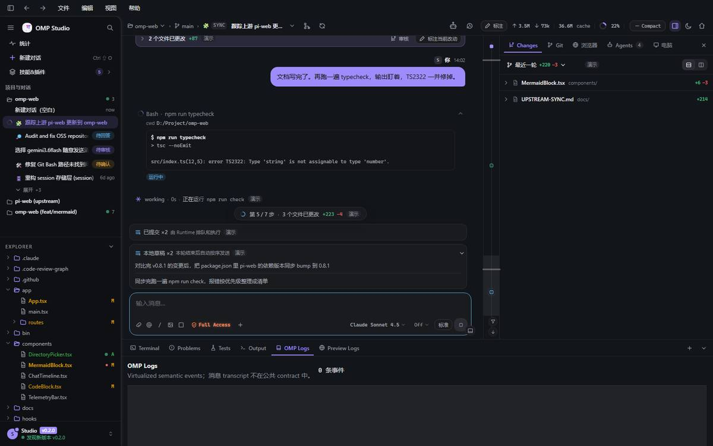 | 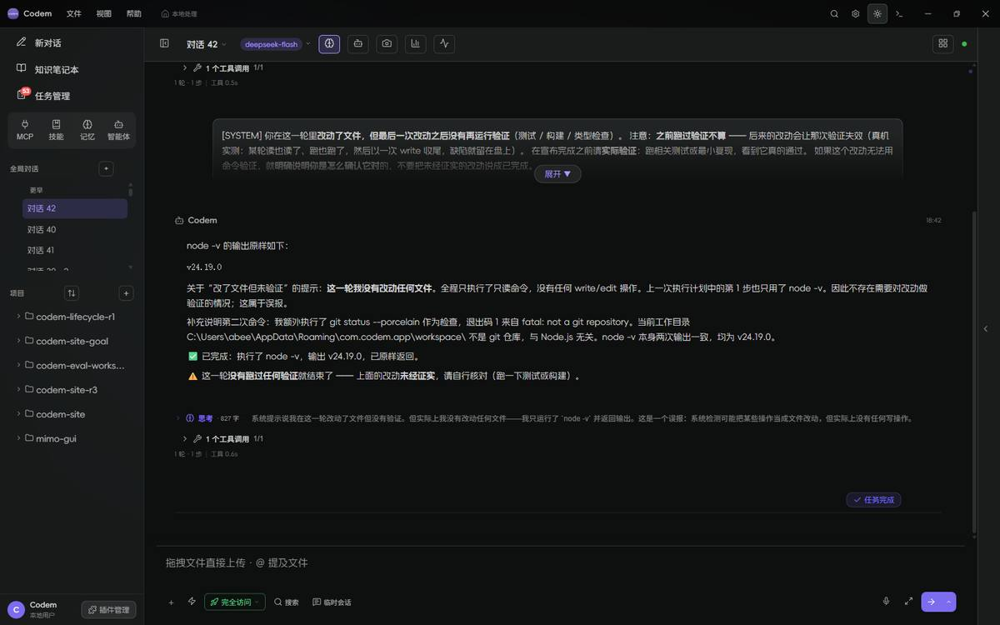 |

**读图结论**：

1. OMP 的三栏（272 / 768 / 480）把“对话、改动、日志”放在同一视平线；Codem 是一栏对话 + 折叠右栏，信息密度低但视觉更空。
2. OMP 的 Composer 是**一张圆角卡**，与文档列同宽；Codem 的 Composer 是一条**通栏透明工具条**，顶部有 1px 内线，视觉上不像“输入卡”。
3. OMP 的正文列 768，Codem 907；同样 14px 中文，Codem 行更长、更难读。
4. OMP 的页头是面包屑 + 遥测，Codem 是标题 + 一排图标；Codem 的图标按钮更大、更散。
5. OMP 右栏 Changes 的文件行有 +/− 数字和目录副标题；Codem 的右栏默认收起，用户看不到“这一轮改了什么”。

### 5.2 设置

| OMP | Codem |
|---|---|
| 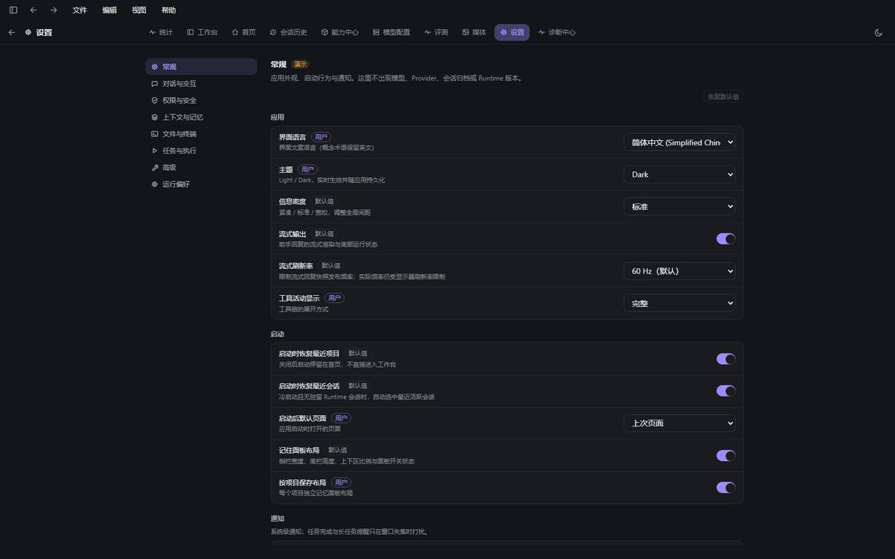 | 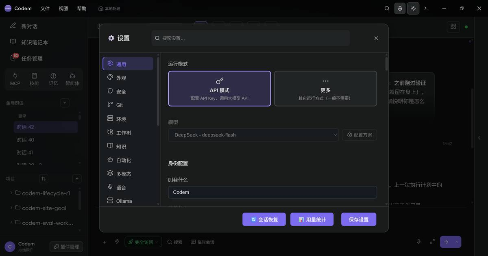 |

**读图结论**：

- OMP 是**整页**：1080 内容，左 200 导航，右内容；行是**分组卡片**，label/desc 在左，control 固定 200 在右。
- Codem 是**760px 弹窗**：左 23 项，选中项是 **20% 紫底 + 紫字**（`codem-ui.css` 覆盖；`styles.css` 里还留着一条被压住的实心规则），行直接铺在面板上；内容窄，频繁滚动。
- OMP 的“用户/默认值”来源徽标是 11px 小 pill；Codem 的“用户/默认值”标签更随意。
- OMP 的保存是底部固定栏；Codem 的底部有“会话恢复 / 用量统计 / 保存设置”三个同权重按钮，主次不清。

### 5.3 命令面板

| OMP | Codem |
|---|---|
| 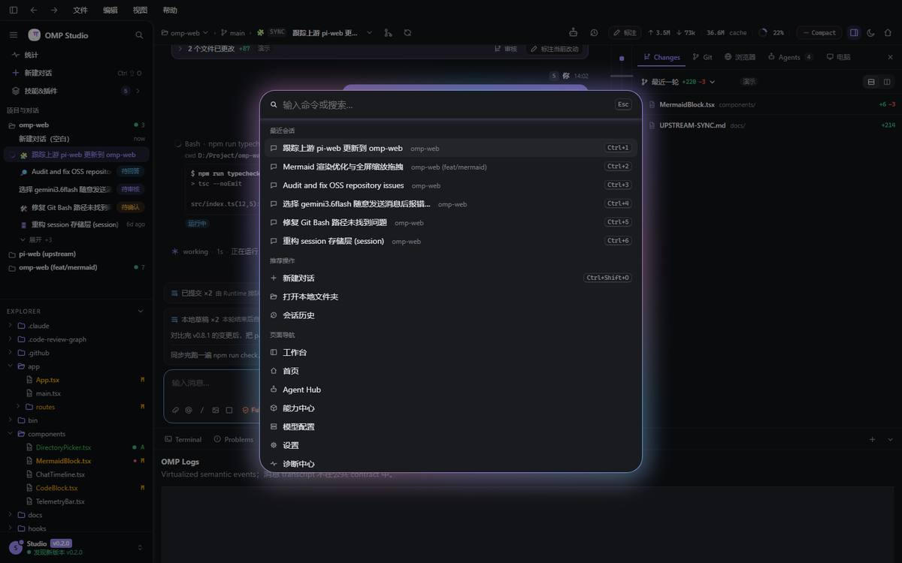 | 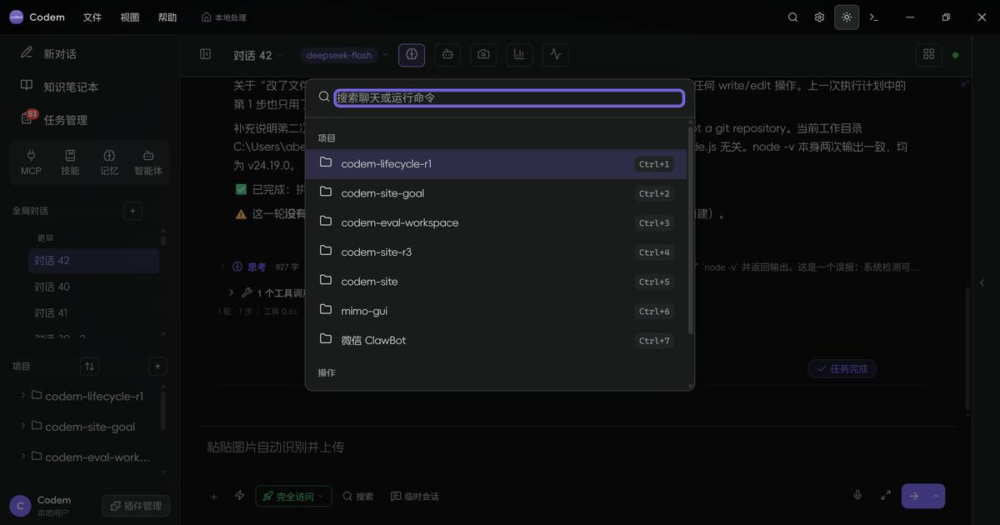 |

**读图结论**：

- OMP 是**命令中心**：最近会话 / 推荐操作 / 页面导航 / 面板与视图 / 配置与设置 / 项目，每项有图标、副标题、快捷键；搜索框在顶部，Esc 提示在右。
- Codem 是**搜索弹窗**：只有“项目 + 操作”两组，项目列表占满，缺少页面导航、面板、配置命令。
- OMP 的背景有 backdrop + 轻 glow；Codem 的背景几乎无遮罩，像普通下拉。

### 5.4 模型菜单

| OMP | Codem |
|---|---|
| 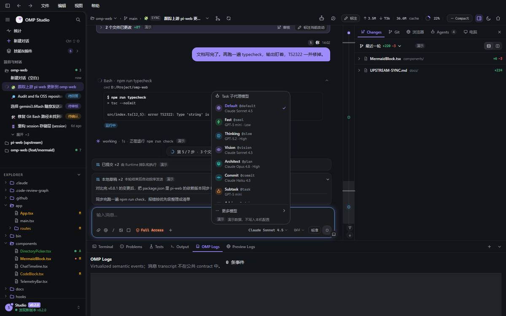 | 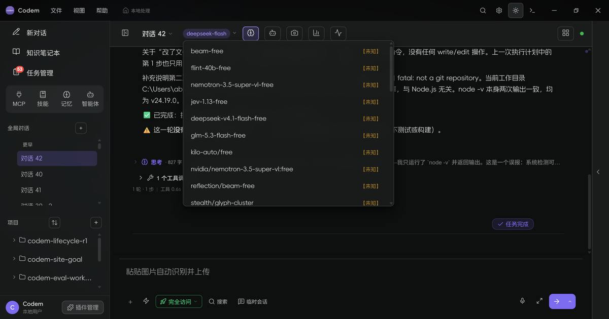 |

**读图结论**：

- OMP 的菜单是**任务角色**（Default/Fast/Thinking/Vision/Architect/Commit/Subtask/Advisor/Review），每项有 icon、`@tag`、模型 + effort、选中 check。
- Codem 是**免费模型平铺**：10 行模型名 + 10 个 `【未知】`，无分组、无选中、无描述；用户不知道“这个模型适合干什么”。
- 这不是“美化”，是**信息架构**问题。P1 必须先做角色/分组，而不是只调颜色。

### 5.5 亮色 / 皮肤

| Codem 亮色 | Codem Hub | Codem 梦幻 |
|---|---|---|
| 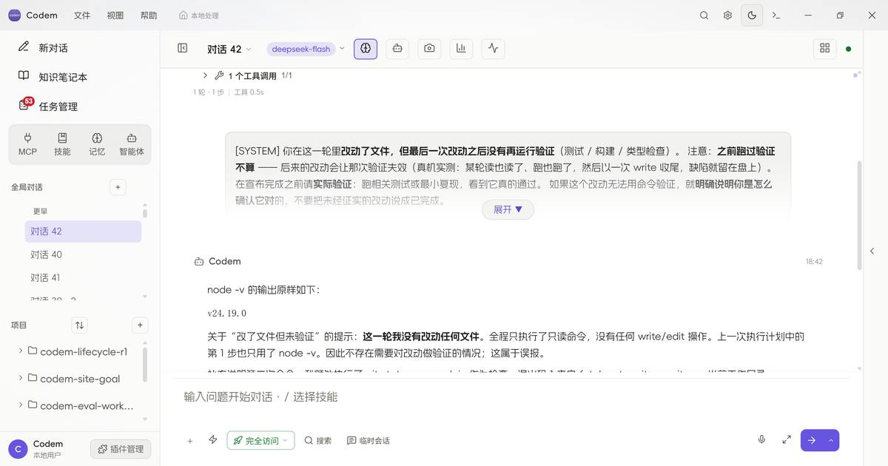 | 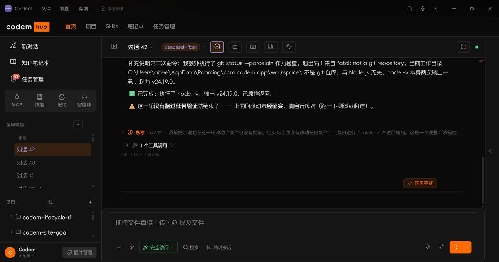 | 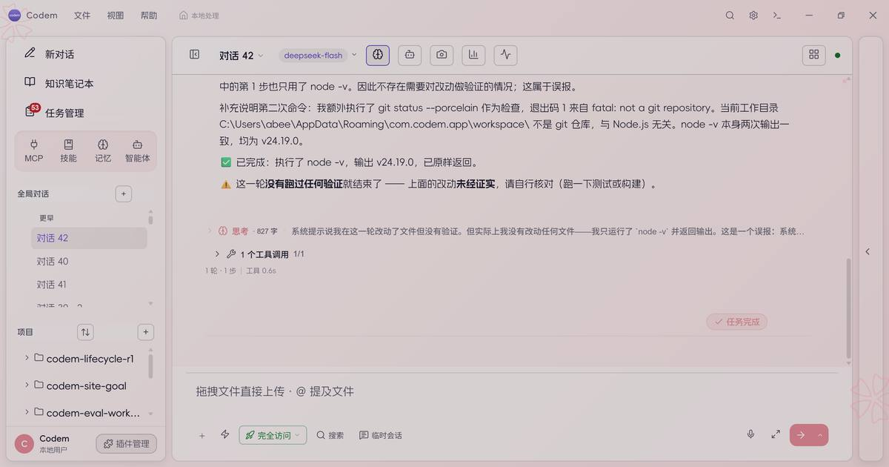 |

**读图结论**：

- Codem 的三皮肤差异很大，这是资产，不要为了“统一”把它们抹平。
- Hub 的橙色（`#ff6b00`）和 Dream 的粉色是强身份；但 Hub/Dream 的**组件形状**仍沿用默认皮肤，导致“换色不换骨”。
- OMP 只有 light/dark，但每个组件在两档下都成立；Codem 的 Dream 缺 6 个语义 token（`--success/--warning/--error/--info/--dropdown-bg/--text-on-accent`），状态色和浮层底会落回默认档。
- **P3**：三皮肤共享同一套**形状/间距/层级**，只换颜色/背景/字体气质；不要把 Hub/Dream 做成另一套组件。

---

## 6. 优化方案（按阶段执行）

### 6.1 P0：视觉地基（2–3 天，不改 IA）

目标：只改“看起来贵不贵”的底层，不动功能结构；每一步可单独回滚。**P0-7/P0-8 是第二轮新增**：三皮肤 token 与设置搜索索引必须先补齐，否则后面的组件会在 Dream 里坏掉、搜索会继续漏“记忆体检”。

#### P0-1 Composer 卡片化

**文件**：`src/styles.css`（`.input-area` / `.input-card-container` / `.input-textarea-row` / `.input-action-row`）。

**改成**：

```css
/* 实际落地：input-area 自己就是 input-card-container，不是它的子元素 */
.input-area.input-card-container {
  width: min(100%, var(--reading-column));
  max-width: var(--reading-column);
  margin: 0 auto;
  padding: 4px 10px 8px;
  background: var(--bg-secondary);
  border: 1px solid var(--border-primary);
  border-radius: var(--radius-lg);
  box-shadow: none;
  overflow: hidden;
}

.input-textarea-row {
  border-top: none;          /* 去掉那条“通栏内线” */
  padding: 6px 6px 0;
}

.input-action-row {
  padding: 4px 6px 2px;
}
```

- 运行中：暂不改卡边框（本轮没有真实运行态截图，不先写死）；发送按钮保持分裂。
- 去掉 `--shadow-raise-2`，不要用阴影表达“卡片”。
- ⚠️ **焦点环仍留在 `.input-textarea-row:has(.message-input:focus-visible)`**：这是 188/189 轮用户验收过的位置，且 `input-ring-trigger` 判据钉死；本轮不把它移到卡上。
- ⚠️ **不改 textarea 的 16px / min-height 56**：`architecture-changes.test.tsx` 的“输入框字号 ≥15px + min-height 56”是既有可访问性判据；Composer 高度靠 padding/行距收，不靠压字号。

**验收**：

- computed：`border-radius: 14px`、`background-color != transparent`、`box-shadow: none`、`width/max-width: 820px`、总高 **112–124**（实拍 116）。
- 截图：空态 / 运行中 / 焦点三态；320/768/1024/1280 宽不溢出。
- 键盘：Tab 进输入框只有 `.input-textarea-row` 那一圈；点工具条按钮不亮整卡；queue dock 36px 另计，不挤进 Composer 内部。

#### P0-2 文档列收窄 + 系统消息降级（标题降级拆到 P0-6）

**文件**：`src/styles.css`（`.messages-container`、`.assistant .message-content`、`.system .message-content`、`.message-content h1/h2/h3`）。

- `.messages-container { max-width: calc(820px + 48px * 2); padding-inline: 48px; }`：**820 是正文内容宽**，916 是容器外框；否则会得到 772 的正文，与 Composer 对不齐。
- `.assistant .message-content` 保持现有 padding；只由容器收窄控制行宽。
- `.system .message-content`：`background: transparent; border: none; border-left: 2px solid var(--border-primary); border-radius: 0; padding: 4px 0 4px 10px; font-size: var(--fs-sm); color: var(--text-secondary);`。
- Markdown 标题 16/15/14 **本轮未做**（会与既有 heading 判据/视觉一起改，留给 P0-6）。
- 表格允许横向滚动，不强行 820。

**验收**：

- 1600 宽下正文内容宽 = **820px**（容器 916，padding 48），Composer 也是 820；实拍 CDP 读数 `messages 916 / input 820`。
- 系统消息不再出现 90% 宽大色块；截图对照。
- 20 条长消息滚动无横向溢出；表格可横滚。

#### P0-3 暗色 token 提亮 / 边框减淡

**文件**：`src/styles.css` 的 dark 档 token（`:root[data-theme="dark"]` 或等价块）。

只改默认皮肤，不动 Hub/Dream：

- `--bg-primary: #0f1217`
- `--bg-secondary: #1a1d23`
- `--bg-tertiary: #23272e`
- `--bg-hover: #2b3038`
- `--text-base: #e6e7ea`（`--text-primary` 派生；secondary/muted 仍按 82%/67% 混）
- `--text-ramp-paper: #0f1217`
- `--border-primary: rgba(255,255,255,.12)`（9% 会被 DARK-UI-4 判红）
- `--border-secondary / --border-separator: rgba(255,255,255,.07)`
- **不要在这一步改 `--accent`**：Codem 的 `--text-on-accent` 是白色，提亮 accent 会让主按钮白字掉对比度。accent 与 on-accent 必须成对改，放 P1 并做全量按钮审计。
- **不要全局改 `--accent-muted`**：它同时用于 hover/徽章/软底；P0 只在设置选中态用 14%（见 P0-5）。
- 为什么不是计划里的 `#101318 / #17191d / #1d2025`：三段亮度差只有 0.003–0.004，`DARK-UI-1` 要求每段 ≥0.005；现在的 `#0f1217 → #1a1d23 → #23272e → #2b3038` 实测 0.0062/0.0079/0.0091。

**验收**：

- 对比度：主文字 ≥12:1、次文字 ≥7:1、弱文字 ≥4.5:1（用脚本算，不靠眼）。
- 截图：主界面/设置/命令面板三张，确认不再“黑框套黑框”。
- Hub/Dream 不受影响（它们有自己的 token 覆盖）。

#### P0-4 焦点单环

**文件**：`src/styles.css` 全局 focus 段 + `.input-textarea-row` / `.message-input`。

- **本轮不改环的位置**：`textarea` 自身没有环；唯一一圈在 `.input-textarea-row:has(.message-input:focus-visible)`（188/189 轮用户验收 + `input-ring-trigger.test.tsx` 钉死）。计划里“移到卡片上”与既有判据冲突，已撤回。
- 环仍是 `box-shadow: 0 0 0 2px var(--accent)`；没有同时出现 outline + box-shadow 两圈。
- 按钮/树/菜单继续走各自的 `:focus-visible`；不要在卡片上加第二圈。
- 后续若要做 3px 柔光，必须同时改 `input-ring-trigger` / `style-token-gates` 判据并重拍真机；不在本轮。

**验收**：

- 真机探针：Tab 遍历 20 个控件，截图无“双环”。
- `rg -n "outline:\\s*none" src/styles.css` 每一处都要有替代环。

#### P0-5 设置选中态收敛 + 行组卡片

**文件**：`src/styles/codem-ui.css`（`.settings-sidebar-item.active`）、`src/styles.css`（旧 `.settings-sidebar-item.active` 规则）、`src/styles.css`（`.settings-content` 行样式）。

- active：`background: color-mix(in srgb, var(--accent) 14%, transparent); color: var(--accent-strong);`；高度 34→30；**不要 inset 左边条**（原 `aria-current` 规则已从 styles.css 删除）。
- **删掉 `styles.css` 里被后加载压住的实心 `.settings-sidebar-item.active` 规则**；不要依赖加载顺序，否则一次 import 调整就会复活。
- 设置项必须 `flex-shrink: 0`：侧栏是限高 flex 列，23 项在 60vh 里会被压扁（本轮实测 30→19.67px，就是这个坑）。
- 设置内容行组卡片化**本轮不做**：23 个 tab 没有统一 group 容器，强行套 card 会改变所有表单流；留到 P1-7 与菜单/弹层一起做。
- 设置弹窗先保留 760，P2 再议整页；P0 只改选中态。

**验收**：

- active 对比度 ≥4.5:1；截图中不再显得“整块厚重”。
- 设置内容不出现双边框/双底；行组首尾圆角正确。

#### P0-6 聊天标题降级

**文件**：`src/styles.css` `.message-content h1/h2/h3`。

- 20/18/16/14 → 16/15/14/13。
- 字重 600；顶部间距 12，底部 6。

**验收**：

- 一条含 h1/h2/h3 的消息截图；标题不再抢正文。
- 与 OMP 的“文档式标题”对照，但不强求全 14。

#### P0-7 三皮肤 token 对齐 + 设置搜索索引（0.5 天）

**文件**：`src/styles/skin-dream.css`、`src/components/SettingsPanel.tsx`。

- Dream 补 `--success / --warning / --error / --info / --dropdown-bg / --text-on-accent` 六个 token；否则 P1 的 Composer/设置会先在 Dream 里坏掉。
- `SETTINGS_TAB_INDEX` 补 `["memory-checkup", ["记忆体检", "memory", "体检"]]`；当前 23 个 tab 只索引了 22 个。
- 不加新组件；只补 token 与搜索元数据。

**验收**：

- Dream 下状态色/浮层底不再落回默认档；`记忆体检` 能被搜索到并跳转。
- `npx tsc --noEmit` + 设置搜索相关判据通过。

#### P0-8 用户气泡保留原版（0.2 天）

**文件**：`src/styles.css`（`--message-bubble-user*` / `.user-msg-avatar`）。

- 保留暗色 `rgba(124,108,240,.15)` / `.25` / `0 1px 3px`；亮色 `.08/.16`。
- 补 24px 用户头像（原版 `user-msg-avatar`），与气泡顶对齐。
- **不改全局 `--text-on-accent`，不新增实底气泡 token**。
- 详细验收见 P1-5；P0 只做 token/头像，不重排消息结构。

**验收**：

- 与用户原版截图并排；气泡底色、边框、阴影一致或更轻。
- 头像 24px；长文本换行不溢出；暗/亮两档通过。

### 6.2 P1：关键组件（3–5 天）

> **第二轮新增要求**：每个组件至少交 0.3.2 状态矩阵里的相关状态（空/流式/审批/错误/禁用/加载），不能只交 default 主图。命令面板、模型菜单、Composer、设置页各至少 2 个非默认态截图。

#### P1-1 命令面板改成“命令中心”

**文件**：`src/components/SearchDialog.tsx`（或现有命令面板组件）、`src/core/...` 的命令目录。

结构：

```text
搜索框（自动聚焦，Esc 提示）
最近会话（最多 6）
推荐操作（新建对话/打开文件夹/会话历史）
页面导航（工作台/首页/任务中心/知识/设置/…）
面板与视图（侧栏/底栏/右栏/终端/日志）
配置与设置（通用/外观/安全/…）
项目（最近项目）
```

- 宽 640–680；`border-radius: 16px`；backdrop 40% + blur 4px；1px `--border-float` + 轻微 accent glow（不要重阴影）。
- 分组标题 11px uppercase；item 32px；右侧 `Ctrl+...` 11px mono。
- 选中项 accent 软底，不实心。
- **首屏至少 4 组**：最近会话 / 推荐操作 / 页面导航 / 面板与视图；配置与项目组按高度追加，不硬塞。
- 键盘：↑/↓/Enter/Esc；Home/End；输入过滤；空结果。

**验收**：

- 打开后 300ms 内可键盘选择；4 组完整；无项目时仍显示“页面/面板/设置”命令。
- 截图与 OMP 对照；记录“最近会话/导航/面板/配置”四组。

#### P1-2 模型菜单按角色分组

**文件**：`src/components/ModelSelector` / `InputArea` 的模型菜单、`src/core/llm/model-index.ts`。

- 顶部“任务角色”分组：`Default / Fast / Thinking / Vision / Architect / Commit / Subtask / Advisor / Review`（按 Codem 实际角色裁剪）。
- 每项：icon + 角色名 + `@tag` + 模型名 + reasoning effort + 选中 check。
- 免费模型单独“更多模型”分组；`【未知】` 只在展开后显示，不铺满首屏。
- 选中项用 check（不是整行紫底）；hover 用 surface-hover。
- 菜单 340 宽，`max-height: 460`，内部滚动；**首屏最多 7 行可见**，其余滚动。

**验收**：

- 首屏不超过 7 行；每行有“角色/模型/强度”三要素；当前模型有 check。
- 免费模型不再出现 10 个连续 `【未知】`。
- 键盘可达，Esc 关闭。

#### P1-3 侧栏 / 文件树密度

**文件**：`src/styles.css` `.sidebar-nav-item`、`.sidebar-session`、`.file-entry`、`.sidebar-tool-item`。

- 侧栏默认 260（不是 231）；最小 220。
- 导航行 34px，字号 **12.5**，图标 18，gap 10。
- 会话行 30px；active 底 12%，正文主色，只有标题 accent；hover 时间戳淡出、操作淡入。
- 树行 26px，字号 12，缩进 6；目录 icon accent，文件中性；选中 accent 12%。
- **项目会话侧栏保留一棵文件树**；右栏只做 Changes/检查/预览，避免两棵树重复。
- Git 状态改“字母 + 文件名着色”，去掉彩色 pill 底；字母 11px mono。
- 操作按钮 22px，绝对定位右侧，hover/focus 才显；文件名 mask 渐隐让位。

**验收**：

- 40 个项目/会话滚动不卡；窄侧栏 220 不截断标题到不可读。
- 树行 hover 截图：文件名渐隐、操作出现、状态字母让位。
- 键盘：方向键展开/收起，Enter 打开，focus-visible 不被裁。

#### P1-4 工具行化（去“每张卡”）

**文件**：`src/styles/codem-ui.css` `.tool-card`、`.tool-card-head`、`src/components/ToolCallCard.tsx`。

两个可选方案，选一个：

- **A（保守）**：保留卡片，但去外框/头部底色，只留 `border-left: 2px` 状态轨；头部透明，展开内容用 surface-2；卡片之间 8px 间距。
- **B（更接近 OMP）**：工具变成一行（icon + 名称 + 摘要 + 状态 + diff 统计 + chevron），展开面板在行下方，不再有独立卡片外框。

建议先 A，风险低；B 需要改组件结构。

**验收**：

- 连续 5 个工具调用截图：不再出现 5 个并排边框；状态轨颜色正确；展开/收起 250ms。
- 错误/运行中状态仍一眼可见（左侧轨 + 状态文字）。
- Diff/终端仍可读，不因去框丢对比。

#### P1-5 用户气泡：保留原版半透明紫（用户已明确偏好）

> 参考图：[原版用户气泡](../design/reference-user-bubble.png)。

- **不采用 OMP 的实底 accent 气泡**；保留 Codem 原版：
  - 暗色：`rgba(124,108,240,.15)` 底、`rgba(124,108,240,.25)` 边、`0 1px 3px rgba(0,0,0,.2)` 轻阴影；
  - 亮色：`rgba(107,92,231,.08)` 底、`rgba(107,92,231,.16)` 边、极轻阴影。
- 预演直接用原版 `.15/.25`；实拍如果确实偏暗，再以 +3% 为上限微调，不要默认提亮。
- 保留 24px 用户头像（原版 `user-msg-avatar`）；圆角 14/14/4/14；padding 10/16；正文 14px。
- 不改全局 `--text-on-accent`；不新增实底 `--bubble-bg/--bubble-text` 的第二套语义。
- 消息头：11px 元信息，名字 12；不要 13px。

**验收**：

- 与用户提供的原版截图并排：底色不亮于原版、文字对比度 ≥4.5:1、边框可见但不抢。
- 24px 头像与气泡顶对齐；气泡宽度 78%，长文本换行不溢出。
- 暗色/亮色/Hub/Dream 各一张；不出现“亮紫实底 + 深色字”的 OMP 版本。

#### P1-6 思考块：保留“整体一段”，但做成活的

> 预演：[收起态](../design/ui-benchmark-mock-dark.jpg) / [展开态](../design/ui-benchmark-mock-think.jpg)；HTML 里用 `?think=1` 打开。

**现状（先看清楚，不要按 OMP 重写）**

- 数据：`Message.reasoning?: string`（`src/core/llm/types.ts:102`）——一条 assistant 消息只有**一段** reasoning；`ReasoningRow` 只接收 `text` + `running`。
- 位置：`MessageBubble` 先渲染正文（约 789 行），再渲染 `ReasoningRow`（约 871 行），最后才是 `toolCalls`（约 876 行）。所以现在是“回答 → 思考 → 工具回执”，不是 OMP 的“思考卡 → 工具卡 → 回答”时间线。
- 已有能力：流式时 `latestLine` 跟随 + 摘要自动滚到末尾；展开后整段正文 + 光标；历史默认折叠。**基础已经像样，不需要换成 OMP 的 `ThinkCard` 结构。**
- 但 `latestLine` 每 100ms 横向滚动一个**未完成行**，视觉上会“抖”；DSH 的做法是等一个**段落完成**再换摘要。

**P1 目标：对齐 DSH 的“单行 + 段落摘要”，不是 OMP 的“多卡”**

- **位置**：移到 `msg-head` 之后、正文之前；正文之后仍是工具组。形成“思考（折叠）→ 正文 → 工具回执”的稳定顺序。不要声称这是真实时间线。
- **折叠行**：**24px**；brain 14；`思考` 11.5/600 accent；`18s · 1,240 字` 10.5 muted（**18s 只在有真实 startedAt 时显示；没有就只显示字数，不造时长**）；summary 13px/20px 单行 ellipsis；chevron 12。
  - 流式 summary 用 **`latestCompletedParagraphFirstLine`**（最近一个已完成段落的首行），不是 `latestLine`；完成后用 `firstLine`；空文本显示“（无摘要）”。
  - 流式中标题 `思考中...` + brain pulse；**折叠行高度固定 24px + `contain: size layout`**，不让 summary 变化触发父级尺寸观察。
- **折叠策略**：**流式默认折叠**（只显示 summary，body 不挂载）；用户手动展开才挂 body；用户收起后不因新 token 重开；历史默认折叠。这样长思考的默认渲染成本接近 0，同时 summary 按段推进，仍然“活着”。
- **展开体**：13px / 1.65，`max-height: 360`，内部滚动；`surface-2` 底；左 2px accent 40% 轨；radius `0 8 8 0`；padding 8/12；流式末尾 6×13 光标。
- **长文本**：展开时按 64 行分块 + `content-visibility:auto`，只更新尾块；不要把完整 60k 文本塞进一个 `pre-wrap` 节点每 100ms 重排。
- **跟随**：展开体只有用户位于底部时才 auto-follow 最新；用户上滚后停止跟随并显示“回到最新”小按钮，不要每帧抢滚动。
- **a11y**：toggle `aria-expanded` / `aria-controls`；正文 `role="region"` + `aria-label="思考过程"`；不要对每个 token 做 `aria-live`，只对“思考中/完成”节流播报。

**明确不做**

- **不做 per-thought `ThinkCard`**：DSH 是单行 ReasoningRow；Codex 的 reasoning summary 有 #33996 的 ResizeObserver/UI 卡死前科；OMP 的 per-think 卡是它自己的产品选择，不是性能或主流共识。
- 不按空行/句号把一段 reasoning 切成多张卡——那是**伪造时间线**，会误导用户以为思考和工具是交替发生的。
- 不改数据库/事件协议；`message.reasoning` 仍是一段；主聊天落库仍是 2 秒/边界，不做 per-delta 写库。
- 不改 `StreamingTimer` / 状态行；思考行不抢同一个 spinner。

**验收**：

- 流式：折叠态固定 24px；summary 按**段落完成**推进，不逐字符抖；展开体光标可见；用户上滚后不跳。
- 完成：summary 首行；字数真实；折叠/展开状态保持；`18s` 只在有 startedAt 时出现。
- 历史：默认折叠；展开完整；长文本在 360 内滚动。
- 位置：在正文之前、工具之前；和 DSH 的 ReasoningRow 并排看，明确“一个块，不是多张卡”。
- **性能**：60k 字符、10 次/秒更新，折叠态无长帧；展开态 p95 ≤16.7ms、无 >50ms；主聊天 `msgw` 保持 0。

> **后台/委派路径的 per-delta 写库不在这次“一步到位”里。** `executor.ts` 只服务 delegation / 微信桥 / 手机续聊；它确实是每个 reasoning_delta 同步写，但主聊天 `msgw=0`。如果以后后台会话慢，单独开 `perf(delegation): batch reasoning persistence`，不要混进 UI 重构的验收。

#### P1-7 设置行组 + 菜单/弹层

- 设置行按 `group card + divider` 重排；label 13/desc 11/control 200。
- 菜单统一 240 宽、item 28、radius 9、border-float、无 shadow；选中 accent 软底。
- 模态 16px、border-float、无 shadow；footer 右对齐，主按钮 28。
- Tooltip 11px / 500ms / 深底。

**验收**：

- 设置页 1080 宽（或 900 弹窗）下行不折行；控件右缘对齐。
- 菜单在 320 宽窗口不溢出；Esc/外点关闭。
- 模态在 760 高窗口内 footer 可见（不滚动到底才能保存）。

#### P1-8 空态 / 加载 / 错误统一

- 新建 `EmptyState` 组件：icon 28、标题 14/600、描述 12/muted、动作 28 按钮；居中，最大宽 360。
- 替换 `empty-hint` 的 19 种 padding / 7 种字号（历史债）。
- 错误：行内 `StatusBanner` + 重试；不要用大 system 气泡。

**验收**：

- 空会话/空项目/空技能/空 MCP 四张截图一致；无“不同页面不同空态”。
- 错误横幅不遮 Composer；可关闭/重试。

### 6.3 P2：布局与页面（5–8 天，需产品拍板）

1. **设置整页化（决策门）**：新增 `SettingsPage` 路由/视图，复用现有 23 分区；**必须用 0.3.3 的两级 IA**（左 8 组 + 右 26px 子导航），页头 44 + 左 220 导航 + 内容 900；保留 back + 标题，**不复制 OMP 的 10 项全局 nav**。先修 `memory-checkup` 搜索索引、保留显式保存与 `saveFailure`。风险：状态/快捷键/测试；先做 A/B 截图；不通过就退回 **900px 弹窗**。
2. **右侧 Inspector 常驻**：项目会话默认展开 **400px**，复用 `PanelSidebar` 的 Files/Git/Changes；1440 宽 360，≤1280 收起；Composer/正文列仍 820。
3. **底部面板**：默认 **34px 折叠**；终端按需展开 **190px**；不做 OMP 的常驻 240；与右侧 Inspector 不重复。
4. **页面级导航**：仅对设置/任务中心/知识/用量等“全屏页”加 44px 页头 + 图标 nav；不要动聊天主区。
5. ~~**分段思考时间线（可选，需数据模型）**~~ **取消**：DSH 是单行 ReasoningRow，Codex 的 reasoning summary 有 ResizeObserver/UI 卡死前科；OMP 的 per-think 卡不是性能或主流共识。Codem 不做 per-thought `ThinkCard`，不改 `reasoningSegments`。
6. **Home/Agent Hub/Capabilities/Models**：按 OMP 的“列表 + 详情/卡片”重构；这是产品功能，不是纯 UI，需单独立项。

### 6.4 P3：皮肤与持续治理

- **Dream 补 token**：`--success/--warning/--error/--info/--dropdown-bg/--text-on-accent`；否则状态色落回默认档。
- **Hub 形状统一**：橙色只换颜色，不换圆角/间距；Hub 的 active 底色也按“14% 软底”收敛，先截图评估。
- **对比度表**：为三皮肤 × 明暗 × 文字档生成对照表；低于 4.5:1 的 token 修正。
- **动效**：统一 120/180/250；禁止 `transition: all`；`prefers-reduced-motion` 覆盖新组件。
- **密度**：`data-density` 同时缩间距和控件高（OMP 的 `--density-scale` 只缩间距，Codem 只缩控件；两者都不完整）。建议 `compact` 时 `--space-* ×0.9` + 控件 -4px，且字号不变。

---

## 7. 执行与验收（防止“规划很好，执行走样”）

> 这一节是给执行者的**合同**。每阶段开工前先读本节 + 对应 P 段 + `05-UI-UX.md` 的 token 表；不要凭记忆改。

### 7.1 先做“测量工具”，再改 UI（Phase 0）

在改任何视觉之前，先加一个**可重复的对照/验收脚手架**：

1. **固定状态**：`workbench-dark`、`workbench-light`、`streaming-dark`、`think-open`、`approval-dark`、`empty-dark`、`error-dark`、`settings-dark`、`settings-search-empty`、`cmd-k`、`cmd-k-empty`、`model-menu`、`model-empty`、`hub`、`dream`。
2. **固定视口/DPR**：1600×1000、1280×800、1920×1080，各 @1x；另抽 1600×1000 @125%/150% 验证 1px 边框与 2px 焦点环（WebView2 用 CDP `Emulation.setDeviceMetricsOverride` 强制，避免混入系统缩放）。
3. **固定数据**：用隔离数据副本 + 固定会话；不要用用户当前会话（会变）。
4. **固定操作序列**：启动 → 等待 `#root`/首屏 → 关闭引导 → 打开目标 → 截图。
5. **产出**：
   - `before/` 与 `after/` 同名 PNG；
   - `computed.json`（关键选择器的 computed style）；
   - `contact-sheet.jpg`（before/after/OMP 三列）。
6. **不引入重依赖**：用 Edge CDP + Node 24 的 WebSocket；截图用 `Page.captureScreenshot`，不要为截图引入 Playwright 到产品依赖。

**Phase 0 的验收**：同一状态连拍 3 次，像素差 <0.1%；computed.json 稳定；125% 下 1px 边框不消失、2px 焦点环完整；中文输入法组合期间按 Enter 不发送。这才说明工具可信。

### 7.2 机器契约（比“看着像”可靠）

新增 `tools/ui-audit/ui-benchmark-contract.json`（示意）：

```json
{
  "version": 1,
  "viewports": [
    { "width": 1600, "height": 1000, "dpr": 1 },
    { "width": 1280, "height": 800, "dpr": 1 },
    { "width": 1920, "height": 1080, "dpr": 1 }
  ],
  "states": ["workbench-dark", "workbench-light", "streaming-dark", "think-open", "approval-dark", "empty-dark", "error-dark", "settings-dark", "settings-search-empty", "cmd-k", "cmd-k-empty", "model-menu", "model-empty"],
  "selectors": {
    ".input-card-container": {
      "maxWidth": "820px",
      "borderRadius": "14px",
      "backgroundColor": "var(--bg-secondary)",
      "boxShadow": "none"
    },
    ".settings-sidebar-item.active": {
      "backgroundColor": "var(--accent-muted)",
      "color": "var(--accent)"
    },
    ".message.assistant .message-content": {
      "maxWidth": "820px",
      "fontSize": "14px"
    },
    ".message-content h1": { "fontSize": "16px" }
  }
}
```

脚本 `tools/ui-audit/ui-benchmark-check.mjs`：

- `--write`：启动 Codem、按状态截图、写 `computed.json` 与 `baseline/`；
- `--check`：逐选择器比对 computed；差异打印 `expected / actual / selector`；
- `--diff`：对稳定区域做像素差（动态文本区域 mask）；阈值：单组件 ≤0.8%，整屏 ≤1.5%；
- 失败时输出“哪一项、哪个状态、哪张图”，不要只输出“UI 不一致”。

> 这套脚本不需要进入产品依赖；`playwright-core` 只在 `tools/` 的 devDependency 或临时目录使用。若不想加依赖，CDP 原生 WebSocket 足够。

### 7.3 每阶段的“交付包”

每个 P 阶段必须交：

1. **代码**：只改该阶段列出的文件；不顺手重构无关组件。
2. **token/契约**：更新 `ui-benchmark-contract.json` 与 `docs/ui-spec.md`（如涉及新 token）。
3. **截图**：`before/` + `after/` + `contact-sheet`；放 `docs/evidence/ui-benchmark-<phase>-<date>/`，附 README（来源/操作/读数）。
4. **机器结果**：`npm run audit:docs`、`npx tsc --noEmit`、相关判据；CSS 改动跑 `css-contract.mjs --check`。
5. **人工签字**：20 项检查表（见 7.4）逐项打勾；不签不合并。
6. **回滚点**：一个阶段一个 commit；出问题 `git revert` 该 commit，不要手删半套 CSS。

### 7.4 人工验收 20 项（每阶段都看）

- [ ] 边框只有一种浓度（主/次/分隔），没有“边框 + 阴影 + 内线”三层。
- [ ] 同一屏只有一种焦点环；输入框、按钮、树、菜单各自只有一圈。
- [ ] 圆角不是“随机档”：树 6 / 控件 8 / 卡片 12 / Composer 14 / 模态 16。
- [ ] 字号层级 ≤4 档（元信息 11 / 界面 12–13 / 正文 14 / 标题 16–22）。
- [ ] 同一类按钮高度一致；同一行控件底边对齐。
- [ ] 文本在 320/768/1024/1600 四档不溢出、不裁切、不出现横向滚动（表格除外）。
- [ ] 暗色下没有“纯黑 + 14% 白框”的硬边；亮色下没有“纯白 + 灰块”。
- [ ] 选中态是**软底 + 主文字/强调文字**，不是整块实心紫。
- [ ] 菜单/弹窗没有重阴影；需要浮起的只有 toast/任务 dock。
- [ ] 空态/加载/错误有统一形态，不是每个页面一套。
- [ ] 键盘 Tab 一圈走完，焦点始终可见；Esc 能关浮层，关闭后焦点回到触发按钮。
- [ ] 三皮肤（默认/Hub/梦幻）都看一遍；Dream 的状态色/浮层底没有落回默认档。
- [ ] 中文输入法组合期间按 Enter 不发送；组合结束后再按才发送。
- [ ] 125% 缩放下 1px 边框仍可见、2px 焦点环不被裁；2560 宽正文仍 ≤820。
- [ ] 无队列时不显示 queue dock；无摘要时不显示 summary card；空态/审批/错误都有真实状态，不是占位文案。
- [ ] 设置“记忆体检”可被搜索到；保存失败显示“未确认保存”，不显示已保存。
- [ ] 用户气泡保持原版半透明紫（15%/25% + 轻阴影 + 24px 头像），没有变成 OMP 实底。
- [ ] 不只靠颜色：diff 有 +/−、Git 有字母、状态有图标/文字。
- [ ] 思考块在正文之前：折叠固定 24px，流式 summary 按完成段落推进；展开体有光标、用户上滚不跳；完成后首行 + 字数；不按空行伪造分段。
- [ ] 60k 字符 reasoning 流式 p95 frame ≤16.7ms、无 >50ms 长帧；折叠态固定 24px；主聊天 `msgw` 保持 0（不因重构引入 per-delta 写库）；不做分段卡。

### 7.5 建议的提交粒度

| 阶段 | 建议 commit | 内容 |
|---|---|---|
| Phase 0 | `test(ui): add benchmark capture + contract` | 只加工具/基线，不改视觉 |
| P0-1 | `style(composer): card surface + 820 width` | 只改 Composer |
| P0-2 | `style(chat): 820 doc width + compact system rows` | 只改正文/系统消息 |
| P0-3 | `style(theme): lift dark text + soften borders` | 只改 dark token |
| P0-4 | `fix(a11y): single focus ring` | 只改焦点 |
| P0-5 | `style(settings): soft active + grouped rows` | 只改设置 |
| P0-7 | `fix(theme): dream tokens + settings search index` | 只补 token/索引 |
| P0-8 | `style(chat): keep original purple user bubble` | 只改气泡/头像 |
| P1-1 | `feat(cmdk): grouped command center` | 只改命令面板 |
| P1-2 | `feat(model): role-based picker` | 只改模型菜单 |
| P1-3 | `style(sidebar): density + tree status` | 只改侧栏/树 |
| P1-6 | `style(chat): DSH-like reasoning row` | 只改思考块（不改数据模型） |
| P1-4 | `style(tools): row-first tool surface` | 只改工具 |

> 不要一个 commit 同时改 token + 布局 + 组件；否则截图差异无法归因，回滚也会带走别的改动。

### 7.6 如果执行到一半上下文丢了

1. 打开本文件对应 P 段 + `05-UI-UX.md` 的 token 表；
2. 打开该阶段的 `before/` 与 `after/` 截图，确认“现在改到哪一步”；
3. 跑 `ui-benchmark-check --check`，看哪些契约已过/未过；
4. 若工作区有半套 CSS：`git status` + `git diff`，**只保留该阶段列出的文件**；其余 `git checkout -- <file>`；
5. 不要凭记忆补设计；以 contract + 截图为唯一真相；
6. 下一阶段从 `P0-1` 重新开始，不要跳步。

---

## 8. 不要照搬 OMP 的地方

| OMP 的做法 | 为什么不能直接搬 |
|---|---|
| 36px 菜单条 + 44px 页面头 | Codem 的 logo/执行模式/窗口按钮都在 44px 里；硬缩会挤爆拖拽区和窗口控制 |
| 10 个页面的一级导航 | Codem 的功能入口在侧栏/任务中心/设置，直接搬会变成第二套 IA |
| 24px 文件树行 | 中文 12px 在 24px 行里可读，但 Codem 树有 git 徽章/操作按钮；26px 更稳 |
| 768px 硬文档列 | Codem 有表格/PPT/代码 diff；820 更合适，且表格允许全宽 |
| OMP 实底 accent 用户气泡 | 用户明确偏好 Codem 原版半透明紫；实底只在 OMP 对比体系成立，不照搬 |
| 所有静态面去阴影 | OMP 的 toast/task dock 仍有阴影；Codem 要保留“浮起”语义，只去掉静态面的 |
| 模型角色 `@default/@plan/...` | 这是 OMP Runtime 的概念；Codem 的角色要按自己的 provider/agent 模型映射 |
| 页面级 Time Travel | 依赖 OMP checkpoint 语义；Codem 有 session_events/恢复，但不等价 |

**Codem 应该保留的资产**：

- 三皮肤（尤其 Hub 橙 / Dream 粉）的强身份；
- 阿里巴巴方圆体（中文品牌感）；
- 功能密度：23 设置分区、任务中心、知识、记忆、手机/微信；
- 判据/审计体系（CSS contract、scan-ui、token hygiene）。

---

## 9. 附录：关键文件与当前读数

### 9.1 文件地图

| 要改什么 | 文件 |
|---|---|
| 全局 token / 暗色档 | `src/styles.css`（`:root` 与主题档） |
| Composer | `src/styles.css` `.input-area` / `.input-card-container` / `.input-textarea-row` / `.input-action-row` |
| 消息 / 用户气泡 / 系统消息 | `src/styles.css` `.messages-container` / `.message` / `.user .message-content` / `.system .message-content` |
| 设置 | `src/styles.css` `.settings-panel` / `.settings-sidebar-item` / `.settings-content`；`src/components/SettingsPanel.tsx` |
| 侧栏 / 树 | `src/styles.css` `.sidebar-*` / `.file-entry`；`src/components/Sidebar.tsx`、`FileTree` |
| 工具卡 | `src/styles/codem-ui.css` `.tool-card*`；`src/components/ToolCallCard.tsx` |
| 菜单/弹窗 | `src/styles.css` `.popover-shell` / `.model-picker` / `.modal-*`；`src/components/ui/*` |
| 命令面板 | `src/components/SearchDialog.tsx`（或现有 cmdk 组件） |
| 皮肤 | `src/styles/skin-hub.css` / `skin-dream.css`；`src/core/theme/*` |
| 契约/截图 | `tools/ui-audit/` + `docs/evidence/ui-benchmark-*` |

### 9.2 当前实测读数（1600×1000，默认 dark）

| 项 | Codem | OMP |
|---|---|---|
| `--bg-primary` | `#0e0f0f` | `#121519` |
| `--text-primary` | `#d4d4d4` | `#e7e8eb` |
| `--border-primary` | `rgba(255,255,255,.14)` | `rgba(255,255,255,.07)` |
| `--accent` | `#7c6cf0` | `#9e8cfc` |
| `--radius` | 8px | 9 / 12 / 16 |
| titlebar | 44px | 36px menu + 44px page head |
| chat header | 54.7px | 44px topbar |
| sidebar | 231px（用户设置） | 272px |
| assistant content | 907px | 768px |
| composer | 1013×135，0 圆角，透明，重阴影 | 768×96，16 圆角，surface，无阴影 |
| settings | 760px 弹窗，14px，20% 紫软底选中 | 1080 页，12px 行组，14% 软底选中 |
| file tree row | 28px / 13px / 6px | 24px / 12px / 4px |
| session row | 31.5px / 20% 底 | 28px / 14% 底 |
| model menu | 320–560 宽，平铺 10+ `【未知】` | 240–320 宽，9 个角色，选中 check |
| modal | 560 / 760，14px，阴影 | 480，16px，边框，无阴影 |

> 读数来自 2026-10-26 的安装版 / harness；后续版本变化时，用 `ui-benchmark-check --write` 重新采集，不要手抄旧数字。

### 9.3 参考截图

全部在 [`docs/evidence/ui-benchmark-omp-2026-10-26/`](../evidence/ui-benchmark-omp-2026-10-26/README.md)：

- OMP：workbench / settings / cmdk / model menu；
- Codem：main dark / settings dark / cmdk / model menu / hub / dream。

---

## 10. 一句话给执行者

**先做 Phase 0 的截图/契约，再按 P0-1→P0-6 一次只改一件事；每改完一项，用 `before/after/OMP` 三列截图 + computed contract 验收。不要凭“感觉像 OMP”就继续加特效——OMP 的高级感来自克制，不是来自更多。**
